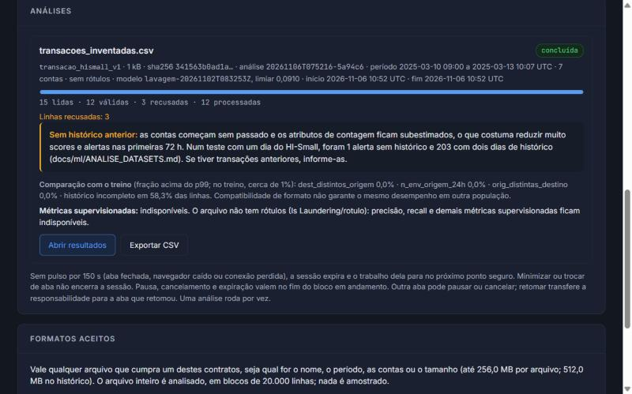
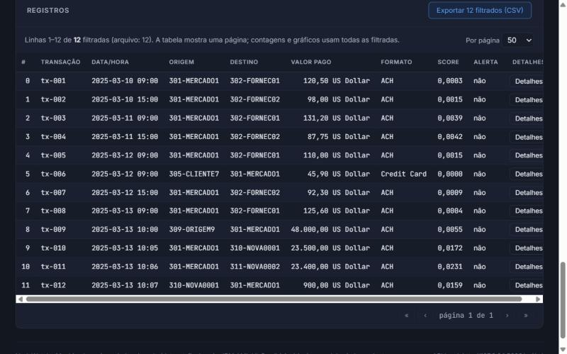

<!--capa
rotulo: Material de estudo e apresentação
titulo: NodeWatch: como explicar o projeto com segurança
sub: Resumo de estudo, perguntas prováveis da professora, roteiro de cinco minutos e lembretes para o ensaio.
Projeto: NodeWatch, Grupo 4
Integrantes: Caio Winkler Marangoni, Guilherme Lombardi, Ryan dos Santos Veloso, Julia Emily Leonardo Barbosa e Guilherme Liborio Camargo
Versão descrita: branch local ml/sessoes-analise-datasets, a partir do commit 9095451, com alterações ainda sem commit (seção 5.3)
Modelos: estado_rede-20261102T083053Z e lavagem-20261102T083253Z (nenhum foi retreinado para este material)
Data: 06/11/2026
-->
# NodeWatch: como explicar o projeto com segurança

**Como usar.** Leia o resumo, estude primeiro as cinco perguntas marcadas com ★ e ensaie o roteiro com cronômetro. Os arquivos que sustentam cada número estão na seção 5, separados das falas. Lá também está a lista do que ainda precisa de confirmação.

**Duas gerações de números.** Os resultados oficiais vêm do modelo atual, reavaliado em 02/11/2026 (*Average Precision* de lavagem 0,464). A comparação com XGBoost e com regras explícitas foi feita antes de uma correção, com a floresta da época (0,461). Compare números apenas dentro da mesma geração.

# 1 Resumo de estudo

## O problema e o que é um alerta

O NodeWatch é um MVP (*Minimum Viable Product*, produto mínimo viável) acadêmico que ajuda uma pessoa analista a decidir **o que investigar primeiro** em transações financeiras. Ele nasceu com grafos e depois ganhou ML (*Machine Learning*, em que o programa aprende com exemplos em vez de seguir regras escritas à mão).

**Um alerta aparece quando o score, a nota dada pelo modelo, alcança um limiar. Ele é um pedido de atenção, não uma prova.** Sozinho, não comprova fraude porque o modelo aprendeu lavagem sintética, não fraude confirmada; o score serve para ordenar e não é uma probabilidade calibrada; e 37% dos alertas de lavagem do teste estavam errados. A conclusão é de uma pessoa, com outras evidências. Sem alerta também não quer dizer seguro: 59% da lavagem do teste não gerou alerta.

## Os dados

| Base | O que representa | Cuidado |
|---|---|---|
| **IBM AML HI-Small** | 5.078.345 transações **sintéticas**, de 01 a 18/09/2022, das quais 5.177 foram marcadas como lavagem pelo simulador | Não são operações de um banco. Os arquivos de contas e de padrões nunca viram atributo |
| **`dataset_final.csv`** | 333.954 medições de 135 caminhos de rede (sonda→âncora), de 28/09 a 05/10/2026, com estado OK, RISCO ou FALHA. Vem do projeto didático "Preditor de Qualidade de Redes" | O estado é gerado por uma regra de limiares. A origem das referências p95/p99 não está documentada |
| **`dados/exemplo_transacoes.csv`** | 16 transações para demonstrar os grafos | Só exemplo |

As duas bases principais não têm chave em comum e são de anos diferentes.

## As três análises

- **Grafos (regras fixas, sem aprendizado).** Cada conta é um vértice, e cada transação, uma aresta direcionada com peso. A DFS (*Depth-First Search*, busca em profundidade) acha ciclos. O algoritmo de Kosaraju acha SCC (*Strongly Connected Component*, grupo em que todos alcançam todos), em O(V + E). A centralidade aponta contas concentradoras. Enumerar todos os ciclos tem pior caso exponencial.
- **Rede (ML).** Prevê o estado da **próxima** medição de um caminho a partir de 21 atributos prontos, como perda, RTT (*Round-Trip Time*, tempo de ida e volta) e jitter (variação do atraso). Anomalia de rede não é indício de fraude.
- **Transações (ML).** Dá uma nota a cada transação a partir de 49 atributos, que são números calculados só com o passado: contagens, somas, par de contas novo, valor atípico, tempo desde o último recebimento.

## O caminho dos dados, com um exemplo inventado

Em `tx-011`, a conta `MERCADO1` recebe 48.000 e, seis minutos depois, paga 23.400 a uma conta nova.

| Etapa | O que o sistema faz | No exemplo `tx-011` |
|---|---|---|
| **Importação** | A interface envia o CSV ou ZIP ao servidor local; a sessão autoriza o pedido | Arquivo com 15 linhas |
| **Validação** | Reconhece o formato pelas colunas e recusa linhas ruins, com o motivo. Nada é preenchido | 12 válidas e 3 recusadas: data "ontem", valor negativo e identificador repetido |
| **Preparação** | Ordena por minuto e calcula os atributos com o estado anterior àquele minuto | Par novo; moedas diferentes; 6 min desde o recebimento; 3 envios em 24 h |
| **Análise** | A Random Forest salva dá o score. Nada é treinado | `score_lavagem` = 0,0231 |
| **Alerta** | Compara o score com o limiar 0,0910 | Abaixo do limiar: **sem alerta** |
| **Atualização** | Incorpora a transação ao histórico das contas | O modelo não muda |
| **Apresentação** | Grava um CSV e mostra tabela, filtros e gráficos. Filtrar não roda o modelo | Linha na tabela. Sem rótulos, não há precisão nem recall |

O repasse parece suspeito para nós, mas o modelo reage ao que aprendeu com o simulador. Isso mostra, de uma vez, que sem alerta não significa seguro e que um arquivo inventado não mede a qualidade do modelo.

## Os modelos realmente implementados

Os critérios de escolha foram o **macro-F1** na rede (média do F1 de cada classe; o F1 equilibra precisão e recall) e a **AP** na lavagem (*Average Precision*, qualidade da ordenação de uma classe rara). **Precisão** é a fração de alertas certos; **recall**, a fração de casos reais encontrados.

| Modelo | Papel | Rede: macro-F1 de validação | Lavagem: AP de validação |
|---|---|---|---|
| **Random Forest** | **Escolhida**: árvores independentes, média das respostas | 0,763 | 0,499 |
| HistGradientBoosting | Candidata: árvores em sequência | 0,762 | 0,445 |
| Regressão logística | Candidata e referência linear | 0,590 | 0,190 |
| Persistência / taxa do formato | Baselines, a régua mínima sem aprendizado: repetir o estado atual; taxa de lavagem por formato de pagamento | 0,711 | 0,0068 |

A floresta foi escolhida pela métrica na validação: ela capta combinações entre atributos e dispensa normalização. Na rede, o empate com HistGradientBoosting é prático. Todos os modelos vêm do **scikit-learn**. **NumPy é uma biblioteca, não um modelo**: com ela foram escritos os atributos e métricas próprias. **XGBoost não está no código**: só foi medido em scripts isolados da auditoria.

## Treino, inferência e histórico

**Treino** muda o modelo e só roda pela linha de comando (CLI, *Command Line Interface*). **Inferência** aplica o modelo pronto a dados novos. **Atualizar o histórico** muda só as contagens e somas das contas daquela análise. Nenhuma tela, rota ou evento treina o modelo.

## Novos datasets, interface e sessão

**Novos datasets.** A área *Analisar dataset* aceita arquivos que cumprem um contrato de colunas: transações no formato IBM ou o equivalente em português, e medições com os 21 atributos prontos. Nome, período e contas podem ser outros. Telemetria bruta e o CSV de grafos são recusados com explicação. Compatibilidade de formato não garante desempenho em outra população.

**Sessão.** Abrir a página só cria uma sessão, uma autorização temporária daquela aba, renovada a cada 15 s. Validar não gera previsões. A análise só começa com o clique e roda no servidor local. Sem pulso por 150 s, a sessão expira e o trabalho para no próximo ponto seguro, com retomada explícita. A sessão controla o uso; não é autenticação.

## Resultados, limitações e próximos passos

Teste da rede: 05/10/2026, 46.105 medições. Teste da lavagem: 09 e 10/09/2022, 862.792 transações, 956 positivas.

| Medida no teste | Referência simples | Modelo | O que significa |
|---|---|---|---|
| Rede: macro-F1 | 0,711 (repetir o estado atual) | **0,750** | Média do F1 de cada classe |
| Rede: falsos alertas por fluxo-hora | 0,73 | **0,31** | Por hora de observação de cada caminho. O ganho vem de menos alarmes falsos |
| Rede: inícios de problema antecipados | 0% | **4,5%** | Quase não antecipa |
| Lavagem: AP | 0,0064 (taxa do formato) | **0,464** | Qualidade da ordenação; o acaso daria 0,0011 |
| Lavagem: precisão e recall | 0,007 e 0,872 | **0,627 e 0,407** | 389 certos em 620 alertas; 389 achados em 956 |

| Situação | Componentes |
|---|---|
| **Disponível** | CLI de grafos; treino e avaliação pela CLI; Analisar dataset; exploração de previsões; sessões; eventos e replay (reenvio de um arquivo como eventos) em demonstração local |
| **Incompleto** | Fusão rede + transação, bloqueada no código; integração só em simulação; painel Grafos estático; fan-out e fan-in (conta que envia para muitas ou recebe de muitas) fora da CLI e do painel; Sentinel AI (chat com modelo externo) não verificado com chave real |
| **Planejado ou ausente** | Extrator `rede_v2`, que calcularia os atributos a partir de telemetria bruta; XGBoost no código; fonte de dados ao vivo; autenticação |

**Limitações.** Lavagem medida só em dados sintéticos. Período de teste já consultado três vezes, logo os números não são inéditos. Nenhum vínculo entre rede e transações. Em positivos sem padrão conhecido (39% do teste), o recall é de 2%. Em fluxos fora do treino, o ganho sobre repetir o estado atual quase some.

**Próximos passos, em ordem.** Congelar candidatos pela validação e medir uma vez em período novo; obter dados com vínculo verificável e rótulos com data; corrigir os defeitos conhecidos dos grafos (A1 a A7); definir requisitos de latência, memória e alertas por dia.

# 2 Perguntas e respostas

As perguntas estão em ordem de importância. Cada resposta foi escrita para durar de 20 a 40 segundos. Entenda o conceito essencial e use suas palavras: a professora pode reformular a pergunta.

**Estude primeiro as cinco perguntas ★.** Elas respondem aos comentários que o grupo recebeu da professora:

| Comentário relatado | Perguntas |
|---|---|
| Comparar a implementação associada ao NumPy com uma referência, e verificar se o ML ganha de regras | ★1 e ★2 |
| Investigar o custo da Random Forest e experimentar XGBoost | ★3 e ★4 |
| Identificar o modelo chamado de regressão e justificá-lo | ★5 |

## ★ 1. NumPy: o que foi implementado

**Pergunta:** “O que vocês implementaram com NumPy? Existe um modelo de vocês feito com essa biblioteca?”

**Resposta sugerida:** NumPy é uma biblioteca de vetores e cálculo numérico, não um algoritmo de aprendizado. Não escrevemos nenhum modelo à mão: todos vêm do scikit-learn. Com NumPy, implementamos o cálculo dos atributos das transações: ordenamos os eventos por conta e minuto, achamos os limites de cada janela por busca binária e somamos por prefixos acumulados. Também escrevemos métricas próprias, como falsos alertas por fluxo-hora. Conferimos esse código contra referências independentes.

**Conceito essencial:** biblioteca não é algoritmo, e importar NumPy não treina nada. O que é nosso é o cálculo *point-in-time*: cada atributo usa só o que aconteceu antes daquele minuto, na janela `[t − w, t)`. Se ela perguntar pelo modelo em NumPy, a resposta honesta é que ele não existe; seria uma peça didática nova, e vale confirmar se ela espera isso (seção 5.3).

## ★ 2. As duas comparações: correção e utilidade

**Pergunta:** “Vocês compararam a implementação de vocês com uma solução que já existe? Isso prova que o ML vale a pena?”

**Resposta sugerida:** São duas perguntas diferentes. A primeira é se o nosso código calcula certo: comparamos atributos e métricas próprias com referências independentes, como força bruta e fórmulas, e isso revelou um erro numérico, que corrigimos. A segunda é se aprender compensa: comparamos os modelos com regras e baselines. Não há modelo próprio para comparar com o scikit-learn, porque não escrevemos nenhum. Ainda falta comparar grafos e ML no mesmo período e confirmar tudo em dados novos.

**Conceito essencial:** comparar com uma referência do **mesmo cálculo** testa a correção. Comparar **métodos diferentes** testa a utilidade. Um resultado não substitui o outro.

| Comparação | O que responde | Situação |
|---|---|---|
| Atributos em NumPy × força bruta; incremental × lote × força bruta | Calcula certo? | **Existe**, em testes do NodeWatch |
| Métricas próprias × fórmulas independentes | Calcula certo? | **Existe**, na auditoria |
| Modelo próprio em NumPy × scikit-learn | Calcula certo? | **Não se aplica**: não há modelo próprio |
| Random Forest × classe majoritária, persistência, prevalência e taxa do formato | Compensa? | **Existe**, com o modelo atual |
| Random Forest × regras explícitas, como "formato ACH e primeira transação do par" | Compensa? | **Existe**, só na auditoria, com a floresta anterior à correção |
| Random Forest × configuração do notebook da professora | Referência | **Existe**: macro-F1 de teste 0,755 × 0,750 |
| Grafos × ML no mesmo período | Compensa? | **Falta**: o número dos grafos vem de um recorte enviesado |
| Nossos resultados × resultados publicados sobre o HI-Small | Referência externa | **Falta** |
| Candidato congelado em período novo | Vale fora do teste já usado? | **Falta** |

## ★ 3. Random Forest e custo de processamento

**Pergunta:** “Por que Random Forest? Ela não custa caro demais para processar?”

**Resposta sugerida:** A Random Forest combina muitas árvores de decisão, cada uma treinada com uma amostra diferente, e usa a média das respostas. Ela capta combinações entre atributos, dispensa normalização e teve o melhor resultado na validação nas duas tarefas, por muito pouco na rede. O custo existe, mas não era o gargalo: o treino levou 12 segundos na rede e de 28 a 52 na lavagem, em CPU. O gargalo era recalcular atributos, cerca de cinco segundos por transação, e o estado incremental resolveu isso.

**Conceito essencial:** separe custo de treino, inferência, tamanho e atributos. Tempos variam entre execuções: recalcular atributos levou 12 s em 02/11 e de 5,4 a 5,6 s em 06/11, na mesma máquina.

- **Tamanho:** a floresta da rede ocupa 17,6 MB comprimida e 57 MB sem compressão.
- **Uma linha com 4 threads** custava 27,7 ms, contra 8,8 ms com uma. Agora, lotes com menos de 1.000 linhas usam uma thread.
- **GPU:** não foi usada nem medida. As anotações do grupo citam a indicação de usar GPU; respondam que os tempos em CPU foram estes, sem comparar com GPU.
- **Empate:** na rede, Random Forest, HistGradientBoosting (HGB) e uma floresta com 50 árvores (5,9 MB) empatam. O notebook da professora recomenda, em empate, o modelo mais barato. Portanto, a floresta atual não é necessariamente a melhor escolha; falta definir requisitos para decidir.
- **Configuração do notebook** (100 árvores, folha 5): macro-F1 de teste maior em 0,0055 (intervalo de confiança de 95%, ou IC 95%, de 0,0007 a 0,0110), com 39 MB e 24 s de treino. Esse teste já foi reutilizado.

## ★ 4. XGBoost: recomendação, implementação e comparação

**Pergunta:** “Vocês testaram XGBoost? Ele é melhor que a Random Forest?”

**Resposta sugerida:** Testamos, mas não adotamos. O XGBoost não está no código do NodeWatch: ele foi medido em scripts isolados, com os mesmos dados e atributos. Na rede, houve empate, com treino mais rápido e modelo menor. Na lavagem, ele foi melhor: AP de teste de 0,509, contra 0,461 da floresta daquela versão, e treino mais curto. Mas esse teste já tinha sido consultado, e o resultado variou muito entre configurações. Antes de trocar, precisamos confirmar num período novo.

**Conceito essencial:** diferencie três coisas. **Recomendação:** a professora sugeriu experimentar. **Implementação:** não existe; `xgboost` não aparece no código nem nas dependências. **Comparação experimental:** existe, na auditoria de 02/11/2026. Random Forest treina árvores independentes e tira a média; XGBoost é *boosting*, com árvores em sequência, cada uma corrigindo as anteriores. Não digam que XGBoost é sempre mais rápido ou melhor: na lavagem, o HistGradientBoosting, que também é boosting, perdeu para a floresta na validação (0,445 × 0,499).

| Na comparação da auditoria | XGBoost | Random Forest | Leitura |
|---|---|---|---|
| Rede: macro-F1 de teste | 0,7515 | 0,7499 | Empate: diferença de +0,0016, IC 95% de −0,0030 a +0,0057 |
| Rede: treino e tamanho | 4,1 s; 0,86 MB | 12,2 s; 17,6 MB | Mais leve, assim como HGB e a floresta com 50 árvores |
| Lavagem: AP de validação | 0,555* | 0,495; 0,525 com a mesma busca | *Otimista: a validação também definiu o número de árvores. Variou de 0,27 a 0,55 entre as 4 tentativas |
| Lavagem: AP de teste | 0,509 | 0,461; 0,478 com a mesma busca | Vantagem de cerca de 0,03 com a mesma busca |
| Lavagem: treino | 6,6 s | 42,7 s; 85,4 s com a mesma busca | Mais rápido nesta medição, com 4 threads |

**Como avaliar de forma justa:** mesmos registros e atributos; mesmo orçamento de busca; escolha e parada antecipada só na validação; candidatos congelados e medidos uma vez em período novo. Na rede, seria telemetria posterior a 05/10/2026; na lavagem, uma replicação declarada, como o HI-Medium. A medição não foi refeita depois da correção do atributo `z_valor_origem`.

## ★ 5. Regressão logística

**Pergunta:** “Por que um algoritmo chamado regressão está resolvendo um problema de classificação?”

**Resposta sugerida:** Apesar do nome, a regressão logística é um classificador supervisionado. Ela combina os atributos com pesos para modelar o logaritmo da chance e transforma o resultado em probabilidade entre zero e um. Com um limiar, isso vira classe. Nossos rótulos são categorias, então o objetivo é classificar, e nenhum regressor numérico existe no projeto. Ela foi candidata e referência linear. Perdeu nas duas tarefas: na lavagem, AP de validação de 0,19 contra 0,50, o que indica que combinações entre atributos pesam.

**Conceito essencial:** `log(p / (1 − p)) = b0 + b1·x1 + …`. O "regressão" vem dessa combinação linear; a saída usada é uma classe. Na lavagem ela é binária; na rede, tem 3 classes. Os rótulos entram como categorias, não como 0, 1 e 2 contínuos. Ela exige imputação, logaritmo e padronização, ajustados só no treino.

**O que ela prova:** na lavagem, AP de 0,19 fica muito acima da taxa do formato (0,0068) e muito abaixo da floresta (0,50). Na rede, seu macro-F1 de validação (0,590) fica abaixo de simplesmente repetir o estado atual (0,711). Por isso, ela fica como referência didática e diagnóstica, não para operação.

**Cuidado:** com `tol=1e-4`, ela parava antes do ótimo na lavagem, em 17 iterações. Com `tol=1e-6`, a AP de validação subiu para 0,19. O teste da versão corrigida não foi medido: o 0,169 de teste é anterior à correção.

## 6. ML ou regras matemáticas

**Pergunta:** “Por que usar ML em vez de apenas regras ou fórmulas matemáticas?”

**Resposta sugerida:** Porque, nos nossos dados, as regras testadas não ordenam bem nem preveem o próximo estado. Na lavagem, a melhor regra explícita, formato ACH com primeira transação do par, encontra 78% dos casos, mas gera mais de 20 mil alertas em dois dias, com precisão de 3,6%. O modelo emite centenas de alertas, com precisão bem maior. Na rede, repetir o estado atual dá macro-F1 de 0,711, e o modelo chega a 0,750, com menos falsos alertas.

**Conceito essencial:** ML também é matemática; a diferença é que os parâmetros são aprendidos. ACH é uma transferência eletrônica em lote, e concentra 87% da lavagem do conjunto, o que pode ser efeito do simulador. Regras continuam úteis porque são conferíveis. Na rede, o rótulo vem de uma regra, então medimos se o modelo antecipa essa regra uma medição à frente; isso não é degradação real independente dela. Com os mesmos 20.575 alertas, a floresta da auditoria achou 82,5%, contra 78% da regra: a vantagem decisiva está nos orçamentos pequenos.

## 7. Limitações e prioridade

**Pergunta:** “Quais são as limitações atuais, e qual melhoria tem maior prioridade?”

**Resposta sugerida:** As principais são: lavagem medida só em dados sintéticos, teste já reutilizado, nenhum vínculo entre rede e transações e nenhuma fonte ao vivo. Na lavagem, 39% dos positivos do teste não pertencem a nenhum padrão conhecido, e neles o recall é de 2%. Na rede, quase não antecipamos o início de um problema. A prioridade é validade: congelar candidatos pela validação e medir uma vez em período novo. Sem isso, trocar de modelo seria escolher pelo teste.

**Conceito essencial:** validade vem antes de desempenho. Recall global esconde grupos: de 0,55 a 0,72 nos oito padrões descritos pelo simulador, 0,52 nas tentativas novas, 0,73 nas já iniciadas antes do teste e 0,02 nos positivos sem padrão. Simulação e replay não são validação em ambiente real.

## 8. Fraude, lavagem e anomalia de rede

**Pergunta:** “Qual é a diferença entre fraude, lavagem de dinheiro e anomalia de rede?”

**Resposta sugerida:** Fraude é enganar alguém para obter vantagem, e nenhum dado do projeto tem fraude confirmada. Lavagem é dar aparência legal a dinheiro de origem ilícita; nosso rótulo é lavagem gerada por um simulador. Anomalia de rede é a previsão de que a próxima medição de um caminho estará em risco ou falha, ou seja, um problema técnico. O título do projeto fala em fraude, mas o que medimos é lavagem sintética e estado de rede, em modelos separados.

**Conceito essencial:** cada termo tem um dado e um rótulo diferentes. Anotações antigas do grupo dizem que `Is Laundering = 1` "significa fraude": não repitam isso. Lavagem não representa todos os tipos de fraude.

## 9. Alerta, falso positivo e falso negativo

**Pergunta:** “O que significa um alerta? Qual é o impacto de falsos positivos e falsos negativos?”

**Resposta sugerida:** Alerta é um score acima do limiar: um pedido para olhar, não uma prova. Falso positivo é alertar algo normal, o que gasta tempo da equipe e incomoda quem é investigado. Falso negativo é deixar passar lavagem, que nem chega a ser investigada. No teste, foram 231 falsos positivos e 567 falsos negativos. O limiar equilibra os dois erros. Usamos o máximo F1 porque não recebemos custos de erro nem capacidade de investigação.

**Conceito essencial:** não existe limiar certo sem custos. Com uma equipe que investiga 1.000 casos por dia, o recall teria sido de 0,54 e 0,62 nos dois dias do teste. Na rede, falso positivo é ruído operacional, e falso negativo é um problema sem aviso.

## 10. Aprendizado supervisionado e rótulos

**Pergunta:** “O aprendizado é supervisionado? De onde vêm os rótulos?”

**Resposta sugerida:** Sim, nas duas tarefas: o modelo aprende com exemplos de resposta conhecida. Na lavagem, o rótulo é a coluna Is Laundering, marcada pelo simulador da IBM, sem investigação real nem data de confirmação. Na rede, o rótulo é o estado da próxima medição, e esse estado segue uma regra de limiares sobre perda, RTT e jitter, que reproduzimos em 99,94% das linhas. Na inferência, os rótulos são opcionais: os scores são iguais com ou sem a coluna.

**Conceito essencial:** supervisionado quer dizer "aprende com respostas", não "usa regressão". A origem do rótulo limita a conclusão: aqui medimos reprodução de um simulador e de uma regra.

## 11. Ligação entre rede e transações

**Pergunta:** “Existe uma ligação comprovada entre os dados de rede e as transações?”

**Resposta sugerida:** Não. As bases não têm chave em comum, são de anos diferentes e vieram de fontes separadas. Por isso, os dois modelos são independentes: o arquivo é único, mas cada parte aprendeu só com os próprios dados. O modelo de fusão está bloqueado no código, e tentar treiná-lo gera um erro que lista o que falta. Existe um laboratório de integração, mas com dados simulados: ele confere regras técnicas e não prova relação nenhuma.

**Conceito essencial:** "modelo unificado" significa um arquivo e uma interface, não um modelo conjunto. Para testar a hipótese seriam necessários transações do mesmo período da telemetria, tabela de vínculo real e rótulos com data. Aí sim daria para comparar "financeiro" e "financeiro + rede".

## 12. Treino, validação, teste e reuso

**Pergunta:** “Como separaram treino, validação e teste? O teste foi usado uma vez só?”

**Resposta sugerida:** Separamos pelo tempo: o passado treina, o período seguinte escolhe modelo e limiar, e o último mede. Na rede, o treino vai até 3 de outubro, a validação é o dia 4 e o teste, o dia 5. Na lavagem, treino de 1 a 6 de setembro, validação nos dias 7 e 8, teste nos dias 9 e 10. O teste não foi usado uma vez só: foi consultado três vezes. O treino nunca leu seus rótulos, mas diferenças pequenas não provam melhoria.

**Conceito essencial:** sorteio aleatório misturaria medições vizinhas no tempo. O notebook da professora ensina que o teste é usado uma vez, então assumam o desvio: avaliação de 26/10, comparação de 9 candidatos e reavaliação de 02/11. O protocolo também foi desenhado depois de ver rótulos de todos os dias. Na lavagem, o treino mantém os positivos e 20% dos negativos, com peso 5; validação e teste mantêm a proporção original. A cauda a partir de 11/09, com 59% de lavagem, fica fora.

## 13. Vazamento de informação

**Pergunta:** “O que é vazamento de informação e como ele pode afetar o projeto?”

**Resposta sugerida:** Vazamento é usar algo que não estaria disponível na hora da previsão. O resultado parece ótimo e não se repete na prática. Nos prevenimos com divisão pelo tempo, janelas que só olham o passado e excluem o próprio minuto, ajustes calculados só no treino e colunas proibidas, como alvo e identificadores. O arquivo de padrões nunca vira atributo, porque é a própria resposta. Um teste confirma que acrescentar transações futuras não muda os atributos.

**Conceito essencial:** há riscos residuais. Na lavagem, 206 de 370 tentativas atravessam a fronteira entre períodos, e o recall é maior nas já iniciadas (0,73) do que nas novas (0,52). Na rede, o código que gerou o CSV não foi fornecido. Sobre `classe_atual`, o notebook fala em potencial vazamento: o modelo escolhido não a usa, e a variante que usa praticamente não muda (0,752 × 0,750).

## 14. Onde entram os grafos

**Pergunta:** “Onde entram os grafos? O ML usa esses algoritmos?”

**Resposta sugerida:** Os grafos são a parte de regras fixas. Cada conta é um vértice, e cada transação, uma aresta direcionada com valor. A busca em profundidade encontra ciclos, o algoritmo de Kosaraju encontra grupos fortemente conectados em tempo O(V mais E), e a centralidade aponta contas concentradoras. Enumerar todos os ciclos pode ser exponencial no pior caso. O ML não usa esses resultados: seus atributos são contagens por conta. Na interface, os grafos são uma demonstração estática; cálculos novos são pela linha de comando.

**Conceito essencial:** o código de `src/ml` não importa os algoritmos de grafos. Cuidado com o número de cerca de 35% das lavagens sinalizadas: ele vem de um recorte montado ao redor de contas com lavagem (3,5% de positivos, contra cerca de 0,1% no arquivo), então não é comparável ao modelo. A CLI imprime "O(V + E)" e "R$", mas a enumeração pode ser exponencial e o CSV não tem moeda. Há defeitos abertos, de A1 a A7.

## 15. Avaliação de qualidade e de desempenho

**Pergunta:** “Como vocês avaliaram a qualidade das previsões e o desempenho do sistema?”

**Resposta sugerida:** São medidas separadas. Qualidade é acertar: medimos em períodos separados pelo tempo, contra baselines, com macro-F1 na rede e Average Precision na lavagem. Desempenho é custo: medimos latência, vazão e memória num benchmark local. Por exemplo, aceitar uma medição pela API levou 27 milissegundos na mediana. Os 193 testes automatizados são outra coisa: verificam se o código cumpre o que promete, sem medir qualidade. Os números de desempenho valem para esta máquina e execução.

**Conceito essencial:** não misturem as três coisas. O tempo do modelo isolado não é o tempo do sistema, e a vazão em lote de 10.199 eventos por segundo não é capacidade da API.

## 16. Acurácia em dados desbalanceados

**Pergunta:** “Por que a acurácia não basta em dados desbalanceados?”

**Resposta sugerida:** Porque o acerto fica dominado pela classe comum. Na lavagem, só 0,11% das transações do teste são positivas: quem responde sempre "não é lavagem" acerta 99,89% e não encontra nada. Na rede, acontece algo parecido: prever sempre OK dá 87% de acurácia e recall zero nas classes de problema. Por isso usamos Average Precision na lavagem e macro-F1 na rede, que dão peso às classes raras. Também olhamos a matriz de confusão.

**Conceito essencial:** a métrica precisa refletir o que importa. A matriz de confusão mostra quais erros acontecem, não só quantos.

## 17. Precisão, recall, F1 e Average Precision

**Pergunta:** “O que significam precisão, recall, F1 e Average Precision?”

**Resposta sugerida:** Precisão é, dos alertas emitidos, quantos estavam certos: no teste da lavagem, 389 de 620, ou 63%. Recall é, dos casos reais, quantos foram achados: 389 de 956, ou 41%. F1 é a média harmônica dos dois: 0,49. Esses três dependem do limiar. A Average Precision resume a qualidade da ordenação sem escolher um limiar: foi 0,464, enquanto o acaso ficaria em 0,0011. Macro-F1 é a média simples do F1 de cada classe.

**Conceito essencial:** sempre compare com a referência. AP de 0,46 parece baixa, mas a linha de base é a prevalência, 0,0011. O score de 0,18 não quer dizer 18% de chance.

## 18. Treino, inferência e histórico incremental

**Pergunta:** “Qual é a diferença entre treinar, inferir e atualizar o histórico? O que o histórico incremental melhora?”

**Resposta sugerida:** Treinar muda o modelo e só acontece pela linha de comando. Inferir aplica o modelo pronto a dados novos. Atualizar o histórico muda só contagens e somas das contas daquela análise. O incremental melhora duas coisas. Custo: pontuar uma transação deixou de exigir cinco segundos de reindexação e passou a frações de milissegundo. Contexto: com histórico, o mesmo arquivo teve 203 alertas, contra 1 sem histórico, mas era um dia do período de treino.

**Conceito essencial:** não é aprendizado on-line, porque o modelo não muda. O 1 × 203 mostra o efeito da falta de passado; não é avaliação do modelo. O cálculo incremental confere com o lote e a força bruta: no dia 10/09, nenhum dos 328 alertas mudou de lado.

## 19. Qualquer dataset ou formatos compatíveis

**Pergunta:** “O sistema funciona com qualquer dataset?”

**Resposta sugerida:** Não com qualquer um: com os que cumprem um contrato de colunas. São dois formatos de transações, o do IBM e o equivalente em português, e um de medições de rede com 21 atributos prontos. Nome, período e contas podem ser outros. Linhas ruins são recusadas com o motivo, e nada é inventado. Telemetria bruta e o CSV de grafos são recusados com explicação. Compatibilidade de formato não garante desempenho, porque o modelo aprendeu com dados sintéticos.

**Conceito essencial:** aceitar o formato é diferente de ser válido para aquela população. Sem rótulos, não há precisão nem recall. Limites: 256 MB por dataset, 512 MB de histórico e uma análise por vez. Testado pela interface até 482.650 linhas de dataset.

## 20. Tempo real

**Pergunta:** “As análises acontecem em tempo real?”

**Resposta sugerida:** Não há fonte ao vivo conectada. O que existe é análise de arquivo, replay de arquivos antigos, rotulado como tal, e uma API local que recebe eventos de quem os enviar. Medimos localmente: uma medição de rede leva 46 milissegundos na mediana, do pedido até a previsão gravada. Já a transação espera o minuto fechar, da ordem de um minuto. A capacidade sob carga concorrente não foi medida. Então dizemos: processamento por eventos em demonstração local, não produção.

**Conceito essencial:** o horário tem resolução de minuto, e transações do mesmo minuto não se enxergam; por isso o minuto precisa fechar. A interface consulta o status a cada 2 s, o que não entra nos 46 ms.

## 21. Interface, sessão e execução

**Pergunta:** “A interface dispara análises sozinha? O que é a sessão?”

**Resposta sugerida:** Não. Abrir a página só cria uma sessão, uma autorização temporária daquela aba, renovada por um pulso a cada 15 segundos. Validar confere o arquivo, sem gerar previsão. A análise só começa no clique em Analisar dataset e roda no servidor local. Se a aba fechar, sem pulso por 150 segundos a sessão expira e o trabalho para no próximo ponto seguro, com retomada explícita. Sessão não é autenticação, e a linha de comando não passa por ela.

**Conceito essencial:** aba em segundo plano não é sessão encerrada. Pedido à API sem sessão recebe HTTP 403. Não há aviso confiável de fechamento de janela; por isso existe o prazo de 150 s.

# 3 Roteiro de cinco minutos

**Duração estimada, a conferir em ensaio.** As falas têm cerca de 620 palavras, o que dá cerca de 125 por minuto. Os números falados tomam mais tempo do que parecem, principalmente no bloco de resultados. Adapte as palavras, mas mantenha as ressalvas.

**Como dividir.** Uma pessoa pode fazer tudo. Com duas: até 2:25 e depois disso. Com três: até 1:15, de 1:15 a 2:25, e o restante. Com cinco: juntem os dois primeiros blocos e façam um bloco por pessoa. Ensaiem as trocas, porque cada uma consome alguns segundos.

## 0:00–0:35: problema e objetivo

> Boa tarde. Somos o Grupo 4, e este é o NodeWatch.
>
> Quem investiga transações financeiras não consegue olhar tudo e precisa decidir por onde começar. O NodeWatch é um protótipo acadêmico que ajuda nessa decisão: ele aponta o que merece atenção primeiro.
>
> Uma ideia guia toda a nossa fala: um alerta do NodeWatch não prova fraude. Ele é um pedido de atenção. A conclusão continua sendo de uma pessoa, com outras evidências.

## 0:35–1:15: dados e tipos de análise

> Usamos duas bases, sem nenhuma ligação entre si. A primeira é o IBM AML HI-Small: cinco milhões de transações sintéticas, geradas por um simulador, com cerca de cinco mil marcadas como lavagem de dinheiro. A segunda é o dataset final: 334 mil medições de 135 caminhos de rede.
>
> Sobre esses dados há três análises. Os grafos usam regras fixas para achar ciclos e grupos de contas. O modelo de rede prevê o estado da próxima medição. E o modelo financeiro dá uma nota a cada transação.

## 1:15–2:25: funcionamento e caminho de uma análise

> Vamos acompanhar uma análise. Quando a interface abre, ela cria uma sessão, uma autorização temporária daquela aba. Nada é processado ainda.
>
> Selecionamos um arquivo de transações inventadas e clicamos em Validar. O servidor confere o formato, linha a linha. Das quinze linhas, doze são válidas. Três foram recusadas, com o motivo, e nada foi preenchido.
>
> Só ao clicar em Analisar dataset o trabalho começa. O sistema ordena as transações pelo tempo e, para cada minuto, calcula 49 atributos, como "esse par de contas é novo?" ou "há quanto tempo a conta recebeu dinheiro?". Ele usa apenas o passado. O modelo já treinado dá a nota e, se ela alcançar o limiar, surge um alerta. Depois, o histórico das contas é atualizado, mas o modelo não muda: aqui não há treino.
>
> Neste exemplo, um repasse com cara de suspeito não gerou alerta. E sem alerta não quer dizer seguro.

## 2:25–3:10: modelos e justificativa

> Todos os modelos vêm da biblioteca scikit-learn. O NumPy, que é uma biblioteca de cálculo, foi usado para escrever os atributos e algumas métricas, não um modelo, e conferimos esse código contra força bruta.
>
> Testamos a regressão logística, que, apesar do nome, é um classificador e serve de referência linear. Testamos também dois métodos de árvores. A Random Forest teve o melhor resultado na validação, por muito pouco na rede, e foi escolhida nas duas tarefas.
>
> O XGBoost foi medido à parte e não está no sistema. Na lavagem ele foi promissor, mas ainda falta confirmar.

## 3:10–4:15: resultados e interpretação

> Agora, os resultados, medidos em períodos posteriores ao treino.
>
> Na rede, usamos o macro-F1, que mede o equilíbrio entre acertar e encontrar em cada classe, sem deixar a classe comum esconder as raras. Repetir o estado atual dá 0,711, e o modelo chega a 0,750. O principal ganho são menos falsos alertas: menos da metade. Mas ele quase não antecipa o início de um problema: só 4,5% das vezes.
>
> Na lavagem, usamos a Average Precision, que mede a qualidade da ordenação. Uma referência pelo formato de pagamento dá 0,006, e o modelo chega a 0,464. No limiar escolhido, 63% dos alertas estavam certos, e 41% da lavagem foi encontrada.
>
> Há ganho sobre referências simples, mas nesses dados sintéticos, e a maior parte dos casos ainda escapa.

## 4:15–5:00: limitações, próximos passos e encerramento

> Temos limitações importantes. A lavagem foi medida só em dados sintéticos, então não sabemos o desempenho em um banco real. O período de teste já foi consultado mais de uma vez, portanto esses números não são inéditos. Não existe vínculo entre rede e transações: por isso, a fusão dos dois modelos está bloqueada no código. E não há fonte de dados ao vivo: o que mostramos é uma demonstração local.
>
> Nossa prioridade é congelar os candidatos e medi-los uma única vez em um período novo.
>
> O NodeWatch ajuda a priorizar. Quem decide é a pessoa. Obrigado.

## Slides sugeridos

| Slide | Acompanha | Conteúdo | Imagem em `docs/img/` |
|---|---|---|---|
| 1. Problema e dados | 0:00–1:15 | "Alerta não é prova"; duas bases, sem vínculo; três análises | `alerta_investigacao.svg` |
| 2. Caminho de uma análise | 1:15–2:25 | Demonstração ou capturas de reserva | `fluxo_analise.svg`; `apresentacao_demo_analise.jpg`; `apresentacao_demo_resultados.jpg` |
| 3. Modelos | 2:25–3:10 | Random Forest escolhida; HGB e logística candidatas; XGBoost fora do código; NumPy nos atributos | `modelo_unificado.svg` |
| 4. Resultados | 3:10–4:15 | Macro-F1, falsos alertas, AP, precisão e recall, sempre ao lado da referência | `divisao_temporal.svg`; tabela do resumo |
| 5. Limites e próximos passos | 4:15–5:00 | Sintético; teste reutilizado; sem vínculo; sem fonte ao vivo; prioridade | Sem imagem: texto curto |

## Demonstração opcional, dentro do bloco 1:15–2:25

A ação usa só 15 linhas inventadas. Na cópia isolada usada no teste de 06/11/2026, validar levou cerca de 0,1 s e analisar, cerca de 0,5 s, com a página já aberta. Clique enquanto fala, sem pausar o roteiro, e cronometrem no ensaio.

**Antes da apresentação:**

1. Na máquina que tem o modelo, abra um terminal na pasta do projeto e rode `.venv\Scripts\python.exe src\sentinel_ai.py`. Não use `start_presentation.ps1`, que exige chave do Gemini.
2. Abra `http://127.0.0.1:5000/legado#ml/analisar` (área Analisar dataset da interface antiga, usada nesta demonstração) e confirme que a sessão aparece como **ativa**.
3. Faça uma vez a sequência abaixo, para o seletor de arquivos abrir na pasta `docs\exemplos`.

**Durante a fala:**

1. Mostre a faixa "Sessão da interface".
2. Em *Dataset*, selecione `transacoes_inventadas.csv` e clique em **Validar arquivo**. Aparece "15 lidas · 12 válidas · 3 recusadas · 0 processadas".
3. Clique em **Analisar dataset**. O cartão, no alto da lista, passa para "concluída".
4. Se ainda houver tempo, clique em **Abrir resultados** e role até *Registros*, no fim da página, para mostrar `tx-011`, score 0,0231, alerta "não".

**Não façam ao vivo:** treinar, carregar o HI-Small, iniciar replay, abrir as análises antigas ou usar o chat Sentinel AI.

**Se falhar:** se o servidor não responder ou a seleção do arquivo passar de cerca de 10 segundos, vá para o slide 2 com estas capturas e troque "selecionamos" por "nesta captura, selecionamos". O resto da fala continua igual. As capturas têm 800 × 499 pixels; se precisarem de mais nitidez no projetor, refaçam-nas no ensaio.

# 4 Lembretes para o ensaio

1. **Alerta não é fraude.** Saibam explicar score, limiar e alerta. Nunca digam "detectamos fraude" nem "63% de chance de ser lavagem": 63% é a precisão no conjunto de alertas do teste.
2. **NumPy não é modelo.** Saibam explicar o cálculo *point-in-time* e as duas comparações: correção e utilidade. Não digam que comparamos um modelo próprio com o scikit-learn.
3. **XGBoost foi medido, não implementado.** Saibam dizer como compará-lo de forma justa. Nunca digam que ele é sempre mais rápido ou melhor, nem que a troca está decidida.
4. **Sintético e teste reutilizado.** Digam sempre "nos dados sintéticos" e "teste já consultado". Replay e laboratório são demonstração: não são tempo real nem validação em ambiente real.
5. **Rede e transações não se ligam.** "Modelo unificado" é um arquivo com partes separadas. Saibam explicar por que a fusão está bloqueada, e não sugiram que uma anomalia de rede ajuda a detectar fraude.

# 5 Apoio: evidências e pontos a confirmar

Esta seção não faz parte das falas. **Repositório de pesquisa** é o clone `AnaliseComplexidade_DeteccaoFraudes`; os demais caminhos são relativos ao NodeWatch.

## 5.1 O que foi conferido para este material, em 06/11/2026

| Conferência | Resultado |
|---|---|
| `python -m pytest testes` | 193 aprovados, 0 falhas |
| Busca nos estimadores de `src/`, `scripts/` e `testes/` | `RandomForestClassifier`, `HistGradientBoostingClassifier`, `LogisticRegression` e `DummyClassifier`. Nenhum `xgboost`, `DecisionTree`, `*Regressor` ou `LinearRegression` |
| Importações em `src/ml` | Nenhum uso de `src/algoritmos` ou `src/grafo` |
| CLI de grafos com o exemplo | 15 vértices, 16 arestas, 3 ciclos, 3 SCC suspeitos; 29.800 no ciclo contra 30.300 no SCC reproduz o defeito A3 |
| Números citados × JSONs de resultados | Conferidos por script: 0 divergências |
| Demonstração pela interface, em cópia isolada, com o modelo real | 15 lidas, 12 válidas, 3 recusadas, 12 processadas; os 12 scores são iguais aos do manual |
| Atributos de `tx-011`, com o código real | `par_novo` = 1, `moeda_diferente` = 1, `min_desde_rec_origem` = 6, `n_env_origem_24h` = 3 |
| Notebook e guia do material da professora | Lidos no `.rar`: origem do `dataset_final.csv`, papel do NumPy, teste usado uma vez, modelo mais barato em empate |

**Não refeito:** treino, avaliação no teste, benchmark, comparação com XGBoost e cenários de queda. Esses números são evidência salva, com as datas indicadas nos arquivos.

## 5.2 Onde está cada resultado

| Assunto | Arquivo |
|---|---|
| Manual completo do sistema | `docs/COMO_FUNCIONA_O_NODEWATCH.md` |
| Rede: macro-F1, matriz, alertas, inícios de evento, fluxos inéditos | `docs/ml/resultados/avaliacao_estado_rede.json`; `docs/ml/RELATORIO_ML.md`, seção 1 |
| Lavagem: AP, precisão, recall, recall por grupo | `docs/ml/resultados/avaliacao_lavagem.json`; `docs/ml/RELATORIO_ML.md`, seção 2 |
| Candidatos na validação | `docs/ml/resultados/treino_estado_rede.json`; `treino_lavagem.json` |
| Modelos, grades e fusão bloqueada | `src/ml/modelos.py` |
| Atributos em NumPy e testes contra força bruta | `src/ml/preparacao.py`; `src/ml/incremental.py`; `testes/ml/test_referencia_financeira.py`; `testes/ml/test_incremental.py` |
| Vazamento | `testes/ml/test_financeiro.py`; `testes/ml/test_rede.py` |
| Auditoria: inventário, NumPy, regressão logística, conclusões | Repositório de pesquisa: `auditoria/ml_feedback_professora/RELATORIO_AUDITORIA_ML.md` |
| XGBoost, floresta com busca, notebook, bootstrap | Repositório de pesquisa: `auditoria/ml_feedback_professora/resultados/TABELAS.md`; `e_benchmark_*.json`; `g_consolidado.json` |
| Regras explícitas | Repositório de pesquisa: `auditoria/ml_feedback_professora/resultados/d_regras.json` |
| Métricas próprias × fórmulas | Repositório de pesquisa: `auditoria/ml_feedback_professora/testes/test_implementacao_propria.py` |
| Latência, vazão, memória, equivalência incremental | `docs/ml/BENCHMARK_EVENTOS.md` |
| Novos datasets; efeito do histórico (1 × 203) | `docs/ml/ANALISE_DATASETS.md`; `docs/ml/evidencias/demo_historico.txt` |
| Sessão e expiração | `src/ml/sessoes.py`; `docs/ml/evidencias/demo_expiracao.txt`; `demo_oculta.txt` |
| Queda e recuperação | `docs/ml/evidencias/demo_queda.txt`; `docs/ml/REVISAO_CONFIABILIDADE_EVENTOS.md` |
| Vínculo e dados que faltam | `docs/ml/CONTRATO_INTEGRACAO.md`; `docs/ml/EVENTOS.md`, seção 9 |
| Grafos: 35% e limites do recorte | `docs/melhorias-e-limitacoes.md` |
| Exemplo inventado | `docs/exemplos/transacoes_inventadas.csv` |

## 5.3 O que confirmar antes da apresentação

1. **Publicação do código.** *Analisar dataset*, as sessões e o manual estão só nesta máquina, sem commit, na branch `ml/sessoes-analise-datasets`. A `origin/main` (`9095451`) não tem `src/ml/analises.py` nem `src/ml/sessoes.py`. Decidam se publicam antes, porque a professora pode procurar no GitHub.
2. **O que a professora espera.** Os comentários chegaram por relato, e a auditoria não identificou com certeza qual documento ela leu. Confirmem se ela espera um modelo escrito em NumPy, se a comparação com uma referência se referia a isso e se ela espera a comparação com GPU.
3. **Origem do `dataset_final.csv`.** O notebook o trata como base do projeto "Preditor de Qualidade de Redes", já rotulada em etapas anteriores. Faltam a procedência da coleta e o período das referências p95/p99. Não digam que é sintético nem que é real sem confirmar.
4. **Como chamar a auditoria.** O manual diz "auditoria externa", mas ela é externa só ao código do NodeWatch. Foi conduzida pelo grupo com apoio de IA, a partir de `prompts/PROMPT_AUDITORIA_ML_FEEDBACK_PROFESSORA.md`. Digam "auditoria do grupo, em scripts isolados". Confirmem também se a disciplina pede declaração de uso de IA.
5. **Máquina da demonstração.** `artefatos_ml/`, com o modelo, não vai para o git. Sem este computador, é preciso retreinar, e o treino não foi refeito para este material. Testem no projetor, com a fonte legível.
6. **Análises antigas na tela.** A lista em *Analisar dataset* mostra 10 análises de testes anteriores, algumas inválidas ou canceladas, com nomes como `banco_norte_setembro.csv`. São recortes do HI-Small e arquivos sintéticos de teste, não dados de banco. Decidam se limpam a pasta, com o servidor parado, ou expliquem caso apareçam.
7. **Sentinel AI e outros pontos não verificados.** O chat com chave real, a queda de energia, a carga HTTP concorrente e a aba oculta em outros navegadores não foram verificados. Não afirmem que funcionam nessas condições.
8. **Anotações antigas e README.** O guia do material diz que o teste "não tem rótulo" e o texto sobre a branch diz que `Is Laundering = 1` significa fraude: as duas frases estão erradas para o nosso projeto. O `README.md` ainda mostra 27 testes (hoje são 193) e cita um `README_LOCAL.md` que não existe.
9. **Duração.** O tempo é uma estimativa. Cronometrem com slides, trocas e demonstração.
