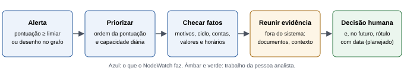
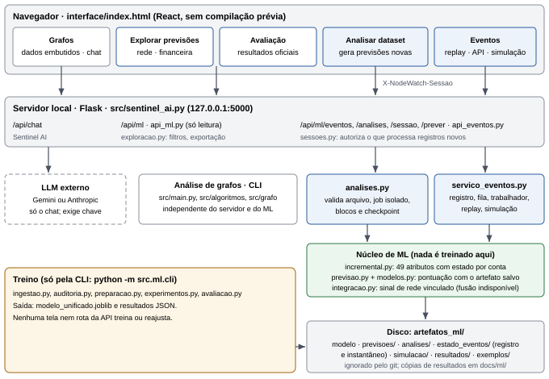
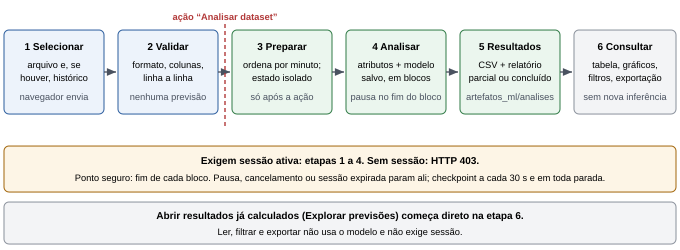
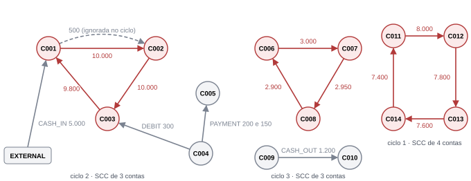
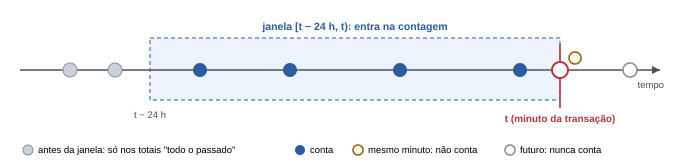
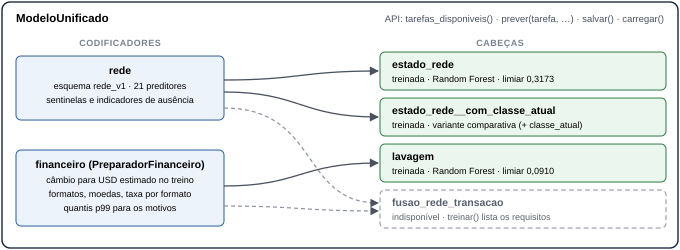
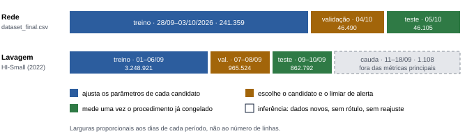
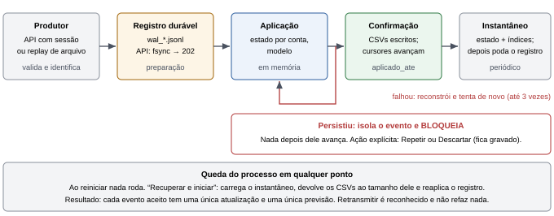

<!--capa
rotulo: Manual técnico e didático
titulo: Como funciona o NodeWatch
sub: O que o sistema faz, como cada análise é feita, como o Machine Learning é usado e o que os resultados permitem concluir.
Projeto: NodeWatch — Sistema de Detecção de Fraudes em Transações Financeiras (Grupo 4)
Integrantes: Caio Winkler Marangoni, Guilherme Lombardi, Ryan dos Santos Veloso, Julia Emily Leonardo Barbosa e Guilherme Liborio Camargo
Versão documentada: branch ml/sessoes-analise-datasets, a partir do commit 9095451, com as alterações da revisão de confiabilidade
Modelos: estado_rede-20261102T083053Z e lavagem-20261102T083253Z (nenhum foi retreinado para este manual)
Data: 06/11/2026
-->
# Como funciona o NodeWatch

**Como ler este manual.** A Parte I é para quem nunca trabalhou com Machine Learning: explica o problema, os dados e como ler um resultado, e traz um tutorial completo. A Parte II traz os detalhes para manter o sistema: fórmulas, formatos, garantias, resultados e arquivos. Os termos são explicados no primeiro uso e reunidos no glossário (seção 17).

**De onde vêm as afirmações.** A fonte é o código atual. Cada resultado indica a origem:

| Marca | Significado |
|---|---|
| **Verificado agora** | Executado em 06/11/2026, na versão documentada, para este manual ou na revisão que o antecede. |
| **Evidência existente** | Resultado salvo de uma execução anterior, com a data. O código correspondente não mudou desde então, salvo indicação. |

**Nenhum modelo foi retreinado** para escrever este documento.

# Parte I — Para entender o sistema

Explicação sem pré-requisitos de Machine Learning: o problema, os dados, o que acontece numa análise, como ler o resultado e um tutorial com dados inventados.

# 1 O que é o NodeWatch

## 1.1 O problema

O NodeWatch é um MVP (*Minimum Viable Product*, produto mínimo viável) acadêmico que ajuda uma pessoa analista a decidir **o que investigar primeiro** em transações financeiras.

A ideia original vem da disciplina de Teoria dos Grafos. Um grafo é um conjunto de pontos ligados por setas: se cada conta é um ponto e cada transação é uma seta, certos desenhos chamam atenção. O dinheiro que sai de uma conta, passa por outras e volta à origem, por exemplo, é um desenho típico da lavagem de dinheiro.

Depois foi acrescentado um módulo de ML (*Machine Learning*, aprendizado de máquina). Nele, um programa aprende com exemplos em vez de seguir regras escritas à mão. São duas tarefas independentes:

- pontuar transações de um conjunto **sintético** de lavagem de dinheiro;
- prever o estado de uma rede de comunicação a partir de medições.

> **O NodeWatch não prova fraude.** Um alerta é um pedido de atenção, não um veredito. A decisão é sempre de uma pessoa, com outras evidências.



## 1.2 Quatro coisas que não se confundem

| Termo | O que significa aqui | O que **não** é |
|---|---|---|
| **Anomalia de rede** | Previsão de que a próxima medição de um caminho de rede estará em RISCO ou FALHA. | Não é indício de fraude. Não existe ligação verificada entre rede e transações. |
| **Comportamento financeiro suspeito** | Desenho no grafo (ciclo, grupo fortemente conectado, conta concentradora) ou fato conferível sobre uma transação. | Não é ilícito por si: folhas de pagamento e comércios também criam esses desenhos. |
| **Previsão de lavagem** | `score_lavagem` igual ou acima do limiar, aprendido em dados sintéticos de **lavagem de dinheiro**. | Não é probabilidade calibrada, não é fraude confirmada, e lavagem não representa todos os tipos de fraude. |
| **Fraude confirmada** | Conclusão de uma investigação humana, com evidência e data. | Nenhum dado do projeto tem esse rótulo. Nenhum componente produz essa conclusão. |

## 1.3 O que existe hoje

Situação na versão documentada:

| Componente | Situação | Observação |
|---|---|---|
| Análise de grafos pela linha de comando (ciclos, SCC, centralidade) | Implementado e verificado | Calcula a partir de um CSV. Tem defeitos conhecidos abertos (seção 8.7). |
| Painel **Grafos** | Implementado, **demonstração estática** | Mostra resultados gravados no HTML das 16 transações de exemplo. Não recebe arquivo. |
| Sentinel AI (chat) | Implementado; **não verificado agora** | Exige chave de um serviço externo, ausente nesta máquina. Verificado só que, sem chave, responde HTTP 503 com a mensagem certa. |
| Detector de fan-out e fan-in | Implementado, verificado por testes; **fora** da CLI e do painel | Usado por testes e por `scripts/benchmark_fan.py`. |
| ML `estado_rede` e `lavagem` (treino, avaliação, inferência) | Implementado e verificado | Lavagem medida só em dados sintéticos. |
| Explorar previsões (tabelas, filtros, gráficos, exportação) | Implementado e verificado | Abre CSVs de previsões já calculadas. |
| **Analisar dataset** (arquivo novo, modelo salvo) | Implementado e verificado | Testado pela interface com arquivos fora dos exemplos. |
| Sessões de uso da interface | Implementado e verificado | Controle de uso, não é autenticação. |
| Eventos: API com aceitação durável, replay, recuperação, bloqueio | Implementado e verificado com queda real e falhas injetadas | Só demonstração local; **não há fonte ao vivo conectada**. |
| Queda de energia ou do sistema operacional | **Verificação pendente** | O código chama `fsync`, mas o cenário não foi executado. |
| Aba oculta em navegadores além do Chrome | **Verificação pendente** | Testado por 7 min no Chrome headless. |
| Capacidade HTTP sob carga concorrente | **Verificação pendente** | Medido um pedido por vez. |
| Integração técnica rede ↔ transação | Implementado, verificado em **simulação** | Dados sintéticos; não comprova relação nenhuma. |
| Modelo de fusão rede + transação | **Incompleto, bloqueado no código** | Treinar falha de propósito e lista o que falta. |
| Extrator de atributos de rede a partir de telemetria bruta (`rede_v2`) | **Planejado** | Depende da referência p95/p99 por fluxo, não documentada. |
| XGBoost | Avaliado por auditoria externa; **não implementado** | Não está no código nem nas dependências. |
| Autenticação de usuários | **Não existe** | O servidor é feito para rodar em `127.0.0.1`. |

# 2 Que dados o sistema recebe

| Dado | O que é | Quem usa |
|---|---|---|
| Transações para grafos | CSV simples: `step,type,amount,nameOrig,nameDest,isFraud` | Análise de grafos pela CLI |
| Transações com banco, moeda e data | Formato do IBM AML ou o mesmo em português (seção 12) | Modelo de lavagem |
| Medições de rede preparadas | CSV com 21 atributos já calculados (`rede_v1`) | Modelo de rede |
| CSV de previsões | Saída já calculada por uma análise anterior | Só para explorar; não gera previsões novas |
| Vínculos | Qual transação ou sessão usa qual caminho de rede, com validade | Integração técnica; hoje só em simulação |
| Perguntas no chat | Texto digitado no painel Grafos | Sentinel AI |

Dois conjuntos foram usados para treinar:

- **`dataset_final.csv`**: telemetria de rede do material da disciplina, de 28/09 a 05/10/2026, com 333.954 medições de 135 caminhos.
- **IBM AML HI-Small**: 5.078.345 transações **sintéticas** de 01 a 18/09/2022, geradas por um simulador (Altman et al., 2023), com 5.177 marcadas como lavagem pelo próprio simulador. Não são transações bancárias reais.

Os dois conjuntos não têm nenhuma chave em comum e são de anos diferentes.

# 3 O que acontece numa análise

Exemplo: você tem um arquivo de transações e quer saber quais merecem atenção.

1. **Você abre a interface.** A página abre uma **sessão**, uma espécie de crachá que diz "há alguém usando". Nada é analisado.
2. **Você seleciona o arquivo e clica em Validar.** O servidor confere colunas, datas e valores, linha a linha. Linhas ruins são recusadas com o motivo; nada é preenchido. Ainda não há previsão.
3. **Você clica em Analisar dataset.** Só agora o trabalho começa.
4. **O sistema põe as transações em ordem de tempo** e cria um histórico vazio só desta análise.
5. **Para cada minuto, calcula atributos.** Atributos são números que descrevem o contexto de uma transação: quanto essa conta enviou nas últimas 24 horas, se o destino é novo, se o valor foge do costume dela. Só entra o que aconteceu **antes** daquele minuto.
6. **O modelo dá uma nota.** Um modelo já treinado recebe os 49 atributos e devolve um número entre 0 e 1, o score. Nada é treinado aqui.
7. **O sistema compara a nota com um limiar.** Se `score_lavagem ≥ 0,0910`, a transação vira **alerta**, com motivos conferíveis.
8. **Atualiza o histórico das contas** e segue para o minuto seguinte. Atualizar o histórico não é treinar: o modelo não muda.
9. **Você consulta os resultados** em tabelas e gráficos e exporta o CSV. Filtrar não refaz nenhum cálculo.

## 3.1 Como o modelo chega a uma nota

O modelo escolhido nas duas tarefas é uma **Random Forest** (floresta aleatória): um conjunto de árvores de decisão. Uma árvore é uma sequência de perguntas sobre os atributos, como "o par origem→destino é novo?" e "enviou mais de X em 24 h?". Cada árvore aprendeu suas perguntas com uma parte diferente dos exemplos do treino. A nota final é a média das respostas de todas.

Isso é **aprendizado supervisionado**: o modelo aprendeu com exemplos cuja resposta era conhecida.

## 3.2 Como ler um resultado

| O que você vê | Como ler |
|---|---|
| `score_lavagem` alto | Parecido com o que o simulador marcou como lavagem. Serve para **ordenar** a fila. Um score de 0,18 não quer dizer "18% de chance". |
| `alerta_lavagem = verdadeiro` | Passou do limiar. Vale olhar. |
| `motivos_verificaveis` | Fatos que você pode conferir, como "primeira transação entre origem e destino". **Não** explicam a decisão do modelo. |
| `historico_incompleto = verdadeiro` | Menos de 72 h de observação antes da transação. Os atributos estão subestimados. |
| Sem alerta | Não quer dizer "seguro". No teste oficial, 59% da lavagem sintética não gerou alerta. |
| `score_alerta_rede` e `alerta_rede` | Estado previsto da **próxima medição** de rede. Nada a ver com fraude. |

## 3.3 Quais conclusões os dados permitem

**Permitem:**

- dizer que, **nos dados sintéticos do HI-Small**, o modelo ordena a lavagem muito melhor que regras simples;
- dizer que, **na telemetria avaliada**, o modelo de rede gera menos falsos alertas que repetir o estado atual;
- conferir ciclos e grupos num arquivo de transações.

**Ainda não permitem:**

- afirmar desempenho em transações reais de um banco ou em outra população;
- afirmar que uma anomalia de rede ajuda a detectar fraude: isso nunca foi medido;
- detectar fraude em geral: o rótulo financeiro é só **lavagem sintética**;
- tratar uma pequena diferença de métrica como melhoria comprovada (seção 15.5).

# 4 Tutorial completo com dados inventados

> **Tudo aqui é inventado.** Contas, bancos, valores e datas foram criados à mão em `docs/exemplos/transacoes_inventadas.csv` só para ilustrar o formato e a leitura. Os scores abaixo não dizem nada sobre o desempenho do modelo.

**Verificado agora**: as saídas abaixo são as reais, com o modelo salvo.

**Passo 1 — Instalar e abrir.** Comandos na seção 16.1. Depois:

```bash
python src/sentinel_ai.py
```

Abra `http://127.0.0.1:5000/legado#ml/analisar` (este tutorial usa a área **Analisar dataset** da interface antiga). A faixa "Sessão da interface" deve mostrar **ativa**. Nada começou. O mesmo arquivo também pode ser analisado no painel do analista, em `http://127.0.0.1:5000/`.

**Passo 2 — O arquivo.** A história inventada: a conta `MERCADO1` faz pagamentos pequenos e regulares. No dia 13, recebe 48.000 de `ORIGEM9` e, em minutos, repassa quase tudo a duas contas novas, com recebimento em outra moeda. As últimas três linhas são erros de propósito.

```text
id_transacao,timestamp,banco_origem,conta_origem,banco_destino,conta_destino,valor_pago,moeda_pagamento,valor_recebido,moeda_recebimento,formato
tx-001,2025-03-10T09:00:00Z,301,MERCADO1,302,FORNEC01,120.5,US Dollar,120.5,US Dollar,ACH
...
tx-009,2025-03-13T10:00:00Z,309,ORIGEM9,301,MERCADO1,48000.0,US Dollar,48000.0,US Dollar,ACH
tx-010,2025-03-13T10:05:00Z,301,MERCADO1,310,NOVA0001,23500.0,US Dollar,23500.0,Euro,ACH
tx-011,2025-03-13T10:06:00Z,301,MERCADO1,311,NOVA0002,23400.0,US Dollar,23400.0,Euro,ACH
tx-012,2025-03-13T10:07:00Z,310,NOVA0001,301,MERCADO1,900.0,US Dollar,900.0,US Dollar,ACH
tx-013,ontem,301,MERCADO1,302,FORNEC01,10.00,US Dollar,10.00,US Dollar,ACH
tx-014,2025-03-13T11:00:00Z,301,MERCADO1,302,FORNEC01,-5.00,US Dollar,5.00,US Dollar,ACH
tx-001,2025-03-10T09:00:00Z,301,MERCADO1,302,FORNEC01,120.5,US Dollar,120.5,US Dollar,ACH
```

**Passo 3 — Validar.** Selecione o arquivo e clique em **Validar arquivo**. O cartão mostra:

| Campo | Valor | Leitura |
|---|---|---|
| Formato | `transacao_hismall_v1` | Reconhecido pelas colunas, não pelo nome. |
| Linhas | 15 lidas, 12 válidas, 3 recusadas | O arquivo tem 15 linhas de dados. |
| Recusas | data/hora inválida (1), valor negativo (1), `id_transacao` repetido (1) | Nada é corrigido nem preenchido. |
| Período | 10/03/2025 a 13/03/2025 | |
| Rótulos | sem rótulos | Métricas de acerto ficarão indisponíveis. |
| Processadas | 0 | Validar não gera previsões. |

**Passo 4 — Analisar.** Clique em **Analisar dataset**. A barra mostra o progresso. Em um arquivo grande, **Pausar** e **Cancelar** valem no fim do bloco em andamento.

**Passo 5 — Ler o resultado.**

| Transação | Quando | Origem → destino | Valor | Score | Alerta | Hist. incompleto |
|---|---|---|---|---|---|---|
| tx-001 | 10/03 09:00 | MERCADO1 → FORNEC01 | 120,50 | 0,0003 | não | sim |
| tx-005 | 12/03 09:00 | MERCADO1 → FORNEC01 | 110,00 | 0,0015 | não | sim |
| tx-006 | 12/03 09:00 | CLIENTE7 → MERCADO1 | 45,90 | 0,00001 | não | sim |
| tx-008 | 13/03 09:00 | MERCADO1 → FORNEC01 | 125,60 | 0,0004 | não | não |
| tx-009 | 13/03 10:00 | ORIGEM9 → MERCADO1 | 48.000,00 | 0,0055 | não | não |
| tx-010 | 13/03 10:05 | MERCADO1 → NOVA0001 | 23.500,00 | 0,0172 | não | não |
| tx-011 | 13/03 10:06 | MERCADO1 → NOVA0002 | 23.400,00 | 0,0231 | não | não |
| tx-012 | 13/03 10:07 | NOVA0001 → MERCADO1 | 900,00 | 0,0159 | não | não |

(As demais linhas têm scores de 0,0009 a 0,0042, sem alerta.)

O que dá para aprender com isso:

1. **O repasse aumentou a nota, mas não houve alerta.** A nota subiu de cerca de 0,001 para 0,023, abaixo do limiar de 0,0910. Sem alerta não quer dizer "seguro".
2. **O modelo reage a padrões do conjunto em que foi treinado.** Uma história que parece suspeita para uma pessoa pode não se parecer com o que o simulador gerou. E o inverso também vale.
3. **tx-005 e tx-006 estão no mesmo minuto.** Nenhuma enxerga a outra, por construção.
4. **Sem rótulos**, a tela diz: "precisão, recall e demais métricas supervisionadas ficam indisponíveis". Sem saber a resposta certa, não há como calcular acerto.
5. **Sem histórico anterior**, as 7 primeiras linhas saem com histórico incompleto, porque a observação começou há menos de 72 h. Se você tiver transações anteriores, informe-as (seção 12.4).

**Passo 6 — Consultar e exportar.** Clique em **Abrir resultados**: tabela, filtros e gráficos usam o CSV gerado, sem nova inferência. **Exportar CSV** baixa as previsões.

Os arquivos ficam em `artefatos_ml/analises/`, e a pasta `artefatos_ml/analises/.jobs/<id>/` guarda a entrada, o estado e o progresso. A interface não oferece exclusão: para apagar, remova os arquivos com o servidor parado.

# Parte II — Referência técnica

Arquitetura, cada análise, Machine Learning de ponta a ponta, formatos, sessão, eventos, resultados, limitações e arquivos.

# 5 Arquitetura

## 5.1 Componentes



| Componente | Onde | Papel |
|---|---|---|
| Interface | `interface/index.html` | Uma página React, sem etapa de compilação. Seções Grafos e Machine Learning. |
| Servidor | `src/sentinel_ai.py` (Flask) | Serve a página, o chat e os blueprints. |
| API de exploração | `src/api_ml.py`, `src/ml/exploracao.py` | Lê previsões e resultados; importa CSV de previsões só em memória. |
| API de processamento | `src/api_eventos.py` | Sessões, eventos, replay, análises e previsão sob demanda. |
| Sessões | `src/ml/sessoes.py` | Quem autoriza processar registros novos. |
| Importação e validação | `src/ml/analises.py`, `src/ml/eventos.py`, `src/ml/esquemas.py`, `src/ml/ingestao.py` | Contratos, leitura e recusa com motivo. |
| Preparação | `src/ml/preparacao.py` (lote), `src/ml/incremental.py` (estado) | Atributos financeiros; matriz de rede. |
| Grafos | `src/main.py`, `src/grafo/`, `src/algoritmos/`, `src/leitura/` | CLI independente do servidor e do ML. |
| ML | `src/ml/modelos.py`, `experimentos.py`, `previsao.py`, `avaliacao.py` | Treino, avaliação e inferência. |
| Eventos | `src/ml/servico_eventos.py`, `registro_eventos.py`, `replay.py`, `simulacao.py` | Registro durável, fila, recuperação, replay, laboratório. |
| Armazenamento | `artefatos_ml/` (ignorado pelo git) | Modelo, previsões, análises, estado de eventos. Não há banco de dados. |
| Relatórios | `docs/ml/` e `src/ml/relatorio.py` | Resultados versionados e relatórios gerados. |

## 5.2 Caminho dos dados



**Executar uma análise nova** (área Analisar dataset, Eventos ou CLI `prever`) usa o modelo e gera um CSV. **Abrir resultados calculados** (Análise de rede, Análise financeira, Avaliação) só lê arquivos: não usa o modelo e não precisa de sessão.

## 5.3 O que roda onde

| Onde | O que acontece |
|---|---|
| **Navegador** | Desenho das telas; consultas periódicas (status a cada 2 s, por padrão); renovação da sessão. Na seção Grafos, todo o cálculo já está gravado no HTML. |
| **Servidor local** | Validação, atributos, modelo, filtros e resumos, escrita de arquivos, chamada ao LLM. |
| **Serviços externos** | Só o Sentinel AI: envia a pergunta e o contexto do painel ao Google Gemini (padrão) ou à Anthropic. |

**Internet e configuração** (verificado no código):

| Item | Necessário para |
|---|---|
| Nada de internet | Grafos, ML, análises e eventos. React e Babel estão em `interface/assets/vendor`. Se esses arquivos faltarem, a página tenta o `unpkg.com`. As fontes vêm do Google Fonts, mas a página funciona sem elas. |
| Chave `GEMINI_API_KEY` (ou Anthropic) em `.env` | Só o Sentinel AI: o chat da interface antiga e o Assistente de dúvidas do painel com o contexto da análise (depois da autorização na tela). Sem ela, `/api/chat` responde 503 e o Assistente de dúvidas responde no modo local. `start_presentation.ps1/.sh` exigem a chave; para usar só o ML, rode `python src/sentinel_ai.py`. |
| `ml_config.local.toml` | Treinar, avaliar e usar o histórico do HI-Small no replay. Analisar dataset não precisa dele. |
| `artefatos_ml/modelo_unificado.joblib` | Qualquer previsão. Ignorado pelo git: gere com `treinar`. |

## 5.4 Sentinel AI

É um assistente de conversa no painel **Grafos**. Recebe a pergunta e um retrato do painel: ciclos, estatísticas, transações de exemplo, dados dos gráficos, SCC, centralidade e um catálogo da interface. Detalhes em `docs/SENTINEL_AI.md`.

| | Sentinel AI | Modelos do NodeWatch |
|---|---|---|
| Tipo | LLM (*Large Language Model*) externo, geração de texto | Random Forest local, classificação |
| Saída | Texto explicativo | Score, classe e alerta, reproduzíveis |
| Dados que usa | Pergunta e estado do painel Grafos. **Não** recebe as previsões de ML | Atributos numéricos |
| Internet | Sim | Não |

O chat explica; não detecta nada e não altera nenhum cálculo. **Atenção:** o que estiver no contexto é enviado ao provedor externo.

# 6 Análises financeiras por grafos

**Verificado agora:** a CLI com o exemplo abaixo. **O código não mudou** desde a auditoria de 02/11/2026 (`git diff` vazio em `src/algoritmos`, `src/grafo`, `src/leitura` e `src/main.py`).

**Objetivo:** encontrar desenhos suspeitos na estrutura das transações. São regras fixas, sem aprendizado: a mesma entrada gera a mesma saída.

**Entrada:** CSV com `nameOrig`, `nameDest` e `amount` (obrigatórias) e `type`, `step` e `isFraud` (opcionais). **Representação:** multigrafo direcionado ponderado (`src/grafo/graph.py`): cada conta é um vértice, cada transação é uma aresta da origem ao destino, com peso igual ao valor. Pode haver várias arestas entre o mesmo par.

> **A interface não calcula grafos.** A seção Grafos mostra resultados pré-gravados das 16 transações de `dados/exemplo_transacoes.csv`, com a faixa "DEMONSTRAÇÃO ESTÁTICA". Para analisar outro arquivo, use a CLI. *Analisar dataset* não faz análise de grafos.

## 6.1 Ciclos

`find_cycles` (`src/algoritmos/cycle_detection.py`) limita a busca às arestas dentro de um mesmo SCC, faz uma DFS (*Depth-First Search*, busca em profundidade) iterativa a partir de cada vértice e registra os ciclos simples, em que nenhuma conta se repete.

- **Categoria:** ANOMALIA para laço da conta nela mesma; CICLO nos demais casos.
- **Prioridade:** pelo tipo de maior risco no caminho: TRANSFER = ALTO, CASH_OUT = MÉDIO-ALTO, PAYMENT = MÉDIO, CASH_IN ou DEBIT = BAIXO.
- **Saída:** caminho, valor, "perda" (primeira aresta menos a última) e intermediárias.
- **Limitações:** ignora a ordem no tempo, então um ciclo pode ser "impossível" no tempo. Enumerar todos os ciclos tem pior caso **exponencial**.

## 6.2 Componentes fortemente conectados (SCC)

`find_scc` (`src/algoritmos/scc.py`) usa o algoritmo de Kosaraju, em duas DFS, com custo O(V + E). Um SCC (*Strongly Connected Component*) é um grupo em que toda conta alcança todas as outras. Grupos com mais de uma conta são marcados como suspeitos. **Limitação:** redes legítimas também formam esses grupos.

## 6.3 Centralidade e pontuação de risco

`compute_centrality` (`src/algoritmos/centralidade.py`):

```text
risk_score = pontos do tipo mais enviado + 15 × (ciclos em que a conta aparece), com teto 100
pontos: TRANSFER 40 · CASH_OUT 30 · PAYMENT 15 · CASH_IN 10 · DEBIT 10 · não envia 0
```

`hub_type`: SUSPEITO (em algum ciclo); DISTRIBUIDOR (envia ≥ 3× o que recebe); COLETOR (envia ≤ ⅓); INTERMEDIÁRIO (grau total ≥ 4); NORMAL. **Limitação:** pesos escolhidos à mão, não calibrados com dados.

## 6.4 Fan-out e fan-in

`find_fan_patterns` (`src/algoritmos/fan_detection.py`) acha contas que enviam para muitas contas (fan-out) ou recebem de muitas (fan-in) numa janela de `step`: padrão de 10 contrapartes em 72 unidades de `step`. **Não está ligado à CLI nem ao painel**; é usado por testes e scripts.

## 6.5 Exemplo

```bash
python src/main.py --input dados/exemplo_transacoes.csv --scc --centralidade
```

Saída real, resumida:

```text
Vértices (contas): 15 · Arestas (transações): 16
CICLO 1 [ALTO]: C011 -> C012 -> C013 -> C014 -> C011   valor 30.800   perda 600
CICLO 2 [ALTO]: C001 -> C002 -> C003 -> C001           valor 29.800   perda 200
CICLO 3 [ALTO]: C006 -> C007 -> C008 -> C006           valor  8.850   perda 100
Centralidade: as contas dos ciclos têm risk_score 55 (40 por TRANSFER + 15 por 1 ciclo), tipo SUSPEITO
```



O ciclo C001→C002→C003 vale 29.800, mas o volume do SCC é 30.300: o ciclo só conta a primeira das transações paralelas (defeito A3, seção 8.7). A CLI imprime "R$" e "tempo O(V + E)", mas o CSV não tem moeda, e a enumeração de ciclos pode ser exponencial.

`--export-json` grava o resultado em `dados/analises/` sem sobrescrever análises anteriores.

Em um recorte de 50 mil transações do HI-Small convertidas por `scripts/converter_ibm_aml.py`, SCC e ciclos mais fan-out/fan-in somados sinalizaram cerca de 35% das lavagens rotuladas. **Evidência existente**, em `docs/melhorias-e-limitacoes.md`. O conversor descarta a moeda.

# 7 Telemetria de rede

**Objetivo:** prever o estado da próxima medição de um caminho de rede.

**Dados:** cada linha é uma medição de um fluxo, um par sonda→âncora (`id_fluxo = probe_id_anchor_id`), a cada 240 s em mediana. **Unidade temporal do alvo:** `alvo` é o estado da **próxima medição do mesmo fluxo**, não do instante atual.

**Medição bruta ou preparada? Só preparada.** O sistema exige os 21 atributos prontos. Telemetria bruta é recusada com o motivo (**verificado agora**: `rtt_ms` recusado por API e laboratório). As razões dividem o RTT (*Round-Trip Time*, tempo de ida e volta) pelo p95/p99 de referência de cada fluxo, e o período dessa referência não está documentado. Calcular uma por conta própria mudaria o significado dos atributos. Um extrator causal seria um esquema novo, `rede_v2`: **planejado**.

| Grupo | Atributos | Significado |
|---|---|---|
| Medição | `perda_pct`, `rtt_ausente`, `delta_ttl_clip`, `ttl_reset`, `perdas_consecutivas` | Perda de pacotes; sem RTT; variação de TTL (*Time To Live*); perdas seguidas. |
| Razões | `razao_rtt_p95`, `razao_rtt_p99`, `razao_jitter_p95`, `amplitude_rtt_rel` | Acima de 1 = pior que o habitual do fluxo. −1 = sem RTT. Jitter é a variação do atraso. |
| Janelas (k = 3, 6, 12) | `perda_media_wk`, `rtt_p95_max_wk`, `jitter_p95_max_wk`, `n_rtt_acima_p95_wk` | Últimas k **medições** do fluxo, incluindo a atual. Contadas em linhas, não em tempo. |
| Identificação | `id_fluxo`, `anchor_id`, `probe_id`, `timestamp` | Obrigatórios; **nunca** viram preditores. |
| Opcionais | `classe_atual`, `alvo`, `split` | Fora dos preditores do modelo escolhido. `alvo` permite avaliação separada. |

**Classes:** a auditoria descobriu a regra que gera o rótulo, reproduzindo `classe_atual` em 99,94% das linhas:

```text
FALHA  se rtt_ausente = 1, ou razao_rtt_p99 > 1, ou perda ≥ 50%
RISCO  senão, se razao_rtt_p95 > 1, ou razao_jitter_p95 > 1, ou há perda
OK     nos demais casos
```

Portanto, a tarefa de ML é **antecipar uma regra** uma medição à frente.

**Saídas:** `classe_prevista` é a classe de maior probabilidade. `score_alerta_rede = P(RISCO) + P(FALHA)`, e `alerta_rede` é verdadeiro se ≥ 0,3173. As duas podem discordar.

**Exemplo (inventado, verificado agora com o modelo real;** `docs/exemplos/medicoes_inventadas_rede.csv`):

| Medição | Sinais | P(OK) / P(RISCO) / P(FALHA) | Classe | Score | Alerta |
|---|---|---|---|---|---|
| 1 | RTT normal | 0,950 / 0,047 / 0,004 | OK | 0,050 | não |
| 2 | RTT 48% acima do p95 | 0,483 / 0,061 / 0,456 | OK | 0,517 | **sim** |
| 3 | RTT alto e 33% de perda | 0,440 / 0,112 / 0,448 | FALHA | 0,560 | **sim** |

Na medição 2, a classe mais provável é OK, e mesmo assim há alerta: o modelo vê quase meio a meio entre continuar bem e falhar.

**Limitações:** quase não antecipa o início de um problema (4,5% dos inícios de evento). Em fluxos fora do treino, o ganho sobre repetir o estado atual quase some (seção 15.2). **Anomalia de rede não é fraude.**

# 8 Transações financeiras e lavagem

**Objetivo:** ordenar transações para que o que se parece com lavagem apareça primeiro. **Entrada:** seção 12. **Saída:** score, alerta e motivos.

## 8.1 Identidade das contas

Uma conta é `banco-conta`: o mesmo número em bancos diferentes são contas diferentes. Bancos precisam ser numéricos.

## 8.2 Janelas temporais

Cada janela é `[t − w, t)`, em minutos inteiros. O próprio minuto `t` fica de fora, porque o horário tem resolução de minuto e a ordem dentro dele não é confiável. Esse cuidado de só usar o passado se chama *point-in-time*.



## 8.3 Os 49 atributos

| Família | Atributos | Janela |
|---|---|---|
| Valor | `log_valor_usd` = log(1 + valor em USD); `sem_taxa_cambio` | transação |
| Envios da origem | `n_env_origem_6h/24h/72h`, `n_env_origem_total`, `soma_env_origem_usd_24h`, `min_desde_env_origem` | janela ou todo o passado |
| Valor atípico | `z_valor_origem` | todo o passado |
| Entrada e saída | `n_rec_origem_24h`, `soma_rec_origem_usd_24h`, `razao_saida_entrada_24h`, `min_desde_rec_origem` | 24 h ou passado |
| Destino | `n_env_destino_24h`, `n_rec_destino_24h/72h`, `min_desde_rec_destino` | 24 h, 72 h ou passado |
| Contrapartes | `par_novo`, `n_par_previas`, `dest_distintos_origem`, `orig_distintas_destino` | todo o passado |
| Da transação | `moeda_diferente`, `mesmo_banco`, `auto_transferencia` | transação |
| Falta de histórico | `sem_historico_env_origem`, `sem_historico_rec_origem`, `sem_historico_rec_destino` | todo o passado |
| Categorias | `formato_*` (7), `moeda_*` (15), em one-hot (uma coluna 0/1 por categoria do treino) | transação |

Identificadores, horário, calendário e rótulos passados **não** são atributos. Arquivos de contas e de padrões também não.

## 8.4 Cálculos

Conferidos em `src/ml/preparacao.py` e `src/ml/incremental.py`.

**Conversão para dólar.** A taxa é a mediana de `recebido ÷ pago` nas transações do treino entre moedas diferentes, propagada entre pares. Foi aprendida no treino e não é reajustada. Moeda sem taxa: valor em USD ausente, `usd = 0` nas somas e `sem_taxa_cambio = 1`.

**Valor atípico:**

```text
z = (x − média) / √(variância + 0,01),   x = log(1 + valor em USD)
z = 0 se a origem fez menos de 2 envios anteriores
```

Média e variância usam todos os envios anteriores da conta. O 0,01 evita valores enormes quando a conta enviou valores quase iguais: equivale a um desvio mínimo de 0,1 em log, cerca de 10% no valor.

Exemplo: envios anteriores com x = 7,0, 7,2 e 7,1 têm média 7,1 e variância 0,0067. Para um envio com x = 10: z = 2,9 / √0,0167 ≈ 22,5.

**Razão saída/entrada:**

```text
razao_saida_entrada_24h = soma enviada em 24 h / (soma recebida em 24 h + 1)
```

Perto de 1: a conta repassa o que recebe. O +1 evita divisão por zero.

**Tempo desde o último evento:** minutos, com teto de 14.400 (10 dias). Sem histórico: 14.400 e o indicador `sem_historico_* = 1`.

**Valores ausentes:** só `log_valor_usd` pode ficar ausente. A Random Forest os recebe como estão. Na regressão logística, que foi candidata, são imputados pela mediana do treino.

## 8.5 Duas implementações dos mesmos atributos

| | Lote: `atributos_financeiros` | Incremental: `EstadoFinanceiro` |
|---|---|---|
| Usado por | Treino, avaliação, CLI `prever` | Analisar dataset, Eventos |
| Como | Ordena e indexa tudo a cada chamada | Mantém estado por conta |
| Custo de 1 transação nova com 5 milhões de histórico | 5,4 a 5,6 s | Frações de milissegundo amortizadas |

**Corrigido em 09/11/2026.** Até então, o lote somava em prefixos acumulados sobre todo o histórico e perdia precisão: até 5,0% em `razao_saida_entrada_24h` no teste do HI-Small e 27% com valores na escala do HI-Large, contra a força bruta. Agora as somas acumuladas recomeçam em cada conta. Lote e incremental coincidem, e os dois ficam abaixo de 1e-6 de erro contra a força bruta. O modelo atual foi treinado com o lote antigo e não foi retreinado: recalculado com o lote corrigido, o teste do HI-Small dá score com diferença máxima de 8·10⁻¹⁷ e **nenhum** dos 620 alertas muda de lado (`docs/ml/hi_large/RELATORIO_HI_LARGE.md`, seção 3.4).

## 8.6 Motivos verificáveis

Fatos simples, só nas linhas em alerta. Não explicam a decisão do modelo.

| Motivo | Regra |
|---|---|
| Formato com taxa de lavagem no treino ≥ 5× a média | Na prática, só ACH |
| Primeira transação entre origem e destino | `par_novo = 1` |
| Envios da origem em 24 h acima do p99 do treino | `n_env_origem_24h > 19.667` |
| Destino com mais origens que o p99 | `orig_distintas_destino > 8` |
| Origem com mais destinos que o p99 | `dest_distintos_origem > 14.230` |
| Valor atípico para a origem | `abs(z) > 3` |
| Origem recebeu fundos há menos de 60 min | `min_desde_rec_origem < 60` |
| Moedas de pagamento e recebimento diferentes | `moeda_diferente = 1` |

Os dois limites muito altos (19.667 e 14.230) são dominados por poucas contas, por isso esses motivos quase nunca aparecem. Revisá-los é uma pendência.

## 8.7 Defeitos conhecidos, abertos

| Defeito | Consequência |
|---|---|
| A1 — prioridade não entra na ordenação dos ciclos | Ordem de saída não segue a prioridade |
| A2 — `risk_score` depende da ordem interna de um conjunto em empate | Pode mudar entre execuções |
| A3 — arestas paralelas ignoradas no valor do ciclo | Valor do ciclo subestimado |
| A4 — `has_cycle` recursivo estoura em caminhos longos | `find_cycles`, iterativo, não é afetado |
| A5 — `add_edges_from` descarta `step` | Fan-out e fan-in sem tempo nesse caminho |
| A6 — `step = inf` derruba a leitura | `OverflowError` |
| A7 — `amount` inválido aceito; linhas sem conta descartadas sem aviso | Volumes distorcidos |

# 9 Machine Learning de ponta a ponta

## 9.1 Biblioteca não é algoritmo

| Peça | O que é | Papel |
|---|---|---|
| **scikit-learn** 1.9.1 | Biblioteca com implementações de modelos | Fornece todos os modelos. Nenhum foi escrito à mão. |
| **NumPy** 2.5.4 | Biblioteca de vetores, **não é um modelo** | Com ela foi escrito o motor de atributos (ordenação + busca binária + somas) e métricas próprias. |
| **pandas**, **pyarrow**, **joblib** | Tabelas, leitura de CSV, salvar objetos | Infraestrutura. |

## 9.2 Quais modelos foram o quê

| Algoritmo | Situação | Observação |
|---|---|---|
| **Random Forest** | **Escolhida** nas duas tarefas | Árvores independentes, média das respostas. |
| **HistGradientBoosting** | Implementado como candidato, avaliado, **não escolhido** | Árvores em sequência. Empate prático na rede. |
| **Regressão logística** | Implementada como candidata, avaliada, **não escolhida** | Apesar do nome, é **classificação supervisionada**: modela o log da chance como combinação linear dos atributos. AP de validação de 0,19 contra 0,50 na lavagem. |
| **XGBoost** | **Só avaliado** por auditoria externa, em scripts isolados | Não está no código. Candidato para confirmação futura (seção 15.5). |
| Baselines | Implementados | Classe majoritária, persistência, prevalência, taxa do formato: a régua mínima. |
| Redes neurais | Não usadas | |

## 9.3 Os dois modelos

| | `estado_rede` | `lavagem` |
|---|---|---|
| **Problema** | Classificação em 3 classes | Classificação binária, usada para ordenar |
| **Variável prevista** | `alvo`: OK, RISCO ou FALHA da próxima medição | `Is Laundering`: 0 ou 1 (verdade do simulador) |
| **Aprendizado** | Supervisionado | Supervisionado |
| **Entrada** | 21 atributos de rede | 49 atributos financeiros |
| **Preparação** | −1 vira ausente em 13 colunas; 3 indicadores `sem_rtt_wk`; remove constantes (`ttl_reset`): 23 colunas no modelo | Remove constantes. Só para a logística: imputa, `sinal(x)·log(1+abs(x))`, padroniza |
| **Treino** | 241.359 linhas | Todos os 2.530 positivos + 20% dos negativos, com peso 5: 651.808 linhas |
| **Candidatos** | 4 logísticas, 4 RF, 4 HGB | 2 logísticas, 1 RF, 2 HGB |
| **Critério de escolha** | Maior macro-F1 na validação | Maior AP na validação |
| **Escolhido** | RF: 150 árvores, folha mínima 20, 50% da amostra, sem pesos | RF: 100 árvores, folha mínima 50, 50% da amostra |
| **Score** | `P(RISCO) + P(FALHA)` | Probabilidade da classe 1, **não calibrada** |
| **Limiar** | 0,3173: máximo F1 de "não OK" na validação | 0,0910: máximo F1 na validação |
| **Versão** | `estado_rede-20261102T083053Z` | `lavagem-20261102T083253Z` |

Sem custos de erro fornecidos, o limiar usa máximo F1. Com custos ou capacidade de investigação, o critério poderia ser outro.

Existe ainda a variante `estado_rede__com_classe_atual`, só para comparação.

## 9.4 Treino, inferência e atualização de histórico

| Etapa | O que muda | Quem faz |
|---|---|---|
| **Treino** | Parâmetros do modelo, câmbio, categorias, limiar | Só a CLI: `python -m src.ml.cli treinar` |
| **Inferência** | Nada no modelo: aplica-o a dados novos | CLI `prever`, Analisar dataset, Eventos, `/prever/rede` |
| **Atualização do histórico** | Só contagens e somas das contas **daquela** análise | `EstadoFinanceiro`, durante a inferência |

Nenhuma tela, rota ou evento treina. Atualizar o estado de uma conta não muda o modelo.

## 9.5 Artefatos

- `artefatos_ml/modelo_unificado.joblib` (36,9 MB): um `ModeloUnificado` com *codificadores* por fonte de dados e uma *cabeça* por tarefa.
- `artefatos_ml/metadados_modelo.json`; cópias em `docs/ml/resultados/`.

"Unificado" quer dizer um arquivo e uma interface, **não** um modelo conjunto: cada cabeça foi treinada só com os próprios dados.



> **Segurança:** arquivos `joblib` e instantâneos `.pkl` executam código ao serem carregados. Carregue apenas os gerados por você.

Na inferência, o estimador usa `n_jobs = 1` em lotes de menos de 1.000 linhas, por uma cópia rasa que não altera o modelo compartilhado.

## 9.6 Separação dos dados e vazamento

*Vazamento* é usar informação que não estaria disponível na hora da previsão, o que torna a avaliação otimista demais.



| Cuidado | Como é aplicado |
|---|---|
| Divisão pelo tempo | Treino antes de validação, antes de teste; lacuna mínima de 3.605 s na rede |
| Atributos só do passado | Janela `[t − w, t)`; teste: acrescentar futuro não muda o resultado |
| Ajustes só no treino | Imputação, escala, câmbio, categorias |
| Colunas proibidas | `alvo`, `split` e identificadores: `matriz_rede` recusa a execução |
| Arquivo de padrões | Nunca vira atributo: é a própria resposta |
| Escolhas | Modelo e limiar na validação; artefato congelado antes do teste |

**Desbalanceamento:** na lavagem, 0,10% das transações são positivas; na rede, FALHA é 3,7%. Por isso a acurácia engana (seção 15.1), usa-se AP e macro-F1, e os negativos do treino são subamostrados com peso. Validação e teste mantêm a distribuição original.

# 10 Explorar previsões existentes

Áreas **Análise de rede** e **Análise financeira**. Lêem CSVs de previsões das pastas `artefatos_ml/{exemplos,previsoes,teste,analises}` e `docs/ml/exemplos`, ou importados (até 64 MB, 4 arquivos, só em memória).

- **Filtros:** período, contas, bancos, valor, moeda, formato, alerta, score, motivo e busca (financeiro); período, fluxo, âncora, sonda, classe, alerta e score (rede).
- **Consulta:** indicadores e gráficos usam todos os registros filtrados; a tabela é paginada (até 200 linhas por página).
- **Exportação:** registros filtrados, até 300.000. Acima disso, a tela explica e o CSV completo está em `artefatos_ml/`.
- **Selos:** arquivo completo, amostra, resultado parcial ou completude desconhecida.
- **Detalhes de um registro:** juntam a previsão com a linha de entrada quando ela é encontrada. **Em resultados de Analisar dataset, os atributos de entrada aparecem como indisponíveis**, porque a entrada fica em pasta própria (verificado agora).

Filtrar nunca roda o modelo. Rede e lavagem nunca são combinadas.

# 11 Interface e sessão

## 11.1 Áreas

| Área | Endereço | Faz |
|---|---|---|
| Grafos | `#grafos` | Demonstração estática e chat |
| Visão geral | `#ml` | Resumo do arquivo selecionado e da avaliação oficial |
| Análise de rede / financeira | `#ml/rede`, `#ml/financeiro` | Explorar previsões |
| Avaliação dos modelos | `#ml/avaliacao` | Resultados oficiais |
| Analisar dataset | `#ml/analisar` | Dados novos |
| Eventos | `#ml/eventos` | Processamento, replay, API, CSV de rede, laboratório |

## 11.2 Controles de uma análise

| Situação | Significado | Ações |
|---|---|---|
| validado, aguardando | Validou; nada foi previsto | Analisar dataset, Cancelar |
| analisando | Em execução | Pausar, Cancelar |
| pausada | Parada com checkpoint; resultado parcial | Retomar, Cancelar, Abrir, Exportar |
| interrompida | O servidor caiu no meio | Retomar, Cancelar |
| cancelada | Definitiva; resultado parcial | Abrir, Exportar |
| erro | Falha; último checkpoint preservado | Tentar de novo, Cancelar |
| concluída | Arquivo inteiro | Abrir, Exportar |

Uma análise roda por vez.

## 11.3 Sessão

Código: `src/ml/sessoes.py` e o gancho `useSessaoML` em `interface/index.html`, no `Dashboard`.

| Evento | O que acontece |
|---|---|
| **Criação** | Ao carregar a página. Recarregar a mesma aba reaproveita a sessão. |
| **Renovação** | Pulso a cada 15 s e ao voltar a ficar visível. |
| **Expiração** | Sem pulso por **150 s**. Quem expirou não volta: a aba abre outra e avisa. |
| **Encerrar sessão** | Vale na hora; o trabalho dela para no próximo ponto seguro. |
| **Várias abas** | Cada uma tem a sua. Todas veem as análises e a responsável ("esta aba", "outra aba"). Qualquer aba ativa pode pausar ou cancelar; retomar transfere a responsabilidade. |
| **Grafos ↔ ML** | Não afeta a sessão. Verificado agora. |

**Aba em segundo plano ≠ sessão encerrada.**

| | Aba oculta ou minimizada | Sessão encerrada ou expirada |
|---|---|---|
| Pulso | Continua, mais espaçado | Parou |
| Trabalho | Continua | Para no próximo ponto seguro |
| Medido agora | Chrome: 15 s → 60 s depois de cerca de 80 s oculta, por 7 min; sessão ativa | Navegador morto, com prazo de demonstração de 5 s: parou em 6,0 s |

Não há aviso confiável de fechamento de janela. **Consequência:** uma aba fechada continua "autorizando" por até 150 s, e o trabalho segue até o fim do bloco seguinte. Em navegadores ou modos de economia que espacem os temporizadores além de 150 s, a sessão expira e o trabalho pausa, com retomada explícita: é seguro, mas interrompe.

## 11.4 O que dispara processamento

| Ação | Dispara? | Observado |
|---|---|---|
| Iniciar o servidor | Não | Trabalhador parado; nenhum replay |
| Abrir a interface | Não | Só cria a sessão |
| Consultar status | Não | Mas carrega o modelo na memória na primeira vez |
| Reabrir com trabalho parado | Não | Mostra e oferece retomada |
| Validar arquivo | Não gera previsões | Lê e confere o arquivo no servidor |
| Pedido à API sem sessão | Não | HTTP 403 |

**Diferenças em relação a "só pela interface":**

- A exigência de sessão vale para as **rotas HTTP**. A CLI (`python -m src.ml.cli prever`) e o uso do pacote em Python **não** verificam sessão: são caminhos diretos para quem tem acesso à máquina (verificado agora).
- A sessão é controle de uso, não autenticação: quem acessa a porta pode abrir uma.
- O produtor de exemplo usa uma sessão existente e não a renova. Encerrada a sessão, ele para.

# 12 Usar novos datasets

Vale qualquer arquivo que cumpra um contrato, sejam quais forem nome, caminho, período, contas ou quantidade de linhas. **Compatibilidade de formato não garante desempenho equivalente em outra população.**

## 12.1 Transações: `hismall_v1` (formato do IBM AML)

Mínimo válido (`docs/exemplos/transacoes_inventadas_formato_ibm.csv`, verificado agora):

```text
Timestamp,From Bank,Account,To Bank,Account,Amount Received,Receiving Currency,Amount Paid,Payment Currency,Payment Format
2025/03/10 09:00,301,MERCADO1,302,FORNEC01,120.50,US Dollar,120.50,US Dollar,ACH
```

## 12.2 Transações: `transacao_hismall_v1` (em português)

```text
id_transacao,timestamp,banco_origem,conta_origem,banco_destino,conta_destino,valor_pago,moeda_pagamento,valor_recebido,moeda_recebimento,formato
tx-001,2025-03-10T09:00:00Z,301,MERCADO1,302,FORNEC01,120.50,US Dollar,120.50,US Dollar,ACH
```

| Campo | Obrigatório | Regra |
|---|---|---|
| Data | sim | IBM: `AAAA/MM/DD HH:MM`. Português: também ISO 8601 ou época em segundos. Sem fuso = UTC. Resolução de minuto. |
| Bancos | sim | Numéricos. |
| Contas | sim | Texto não vazio. Identidade: `banco-conta`. A 1ª `Account` é a origem; a 2ª, o destino. |
| Valores | sim | Números de 0 a 1e15, em unidades da moeda indicada, com ponto decimal. |
| Moedas | sim | Texto. As do treino: Australian Dollar, Bitcoin, Brazil Real, Canadian Dollar, Euro, Mexican Peso, Ruble, Rupee, Saudi Riyal, Shekel, Swiss Franc, UK Pound, US Dollar, Yen, Yuan. |
| Formato | sim | Texto. Os do treino: ACH, Bitcoin, Cash, Cheque, Credit Card, Reinvestment, Wire. |
| `id_transacao` | sim, em português | Único. No formato IBM, a identidade é a linha. |
| Rótulo | **não** | `Is Laundering` (IBM) ou `rotulo` (português): 0 ou 1. |

Moedas e formatos fora do treino são aceitos e **sinalizados**. Moeda sem taxa não tem taxa inventada.

## 12.3 Medições: `rede_v1`

```text
id_fluxo,anchor_id,probe_id,timestamp,perda_pct,rtt_ausente,razao_rtt_p95,razao_rtt_p99,razao_jitter_p95,amplitude_rtt_rel,delta_ttl_clip,ttl_reset,perda_media_w3,rtt_p95_max_w3,jitter_p95_max_w3,n_rtt_acima_p95_w3,perda_media_w6,rtt_p95_max_w6,jitter_p95_max_w6,n_rtt_acima_p95_w6,perda_media_w12,rtt_p95_max_w12,jitter_p95_max_w12,n_rtt_acima_p95_w12,perdas_consecutivas
9001_501,501,9001,1760000000,0,0,0.92,0.81,0.30,0.01,0,0,0,0.95,0.40,0,0,0.97,0.44,0,0,0.98,0.50,0,0
```

Valores inventados; faixas em `docs/ml/DICIONARIO_DADOS.md`. Com três medições assim, os indicadores de deriva não dizem nada: é pouca amostra.

## 12.4 Histórico anterior

**Opcional, mas muda muito o resultado.** O modelo foi treinado com contas que têm passado. **Verificado agora**, no mesmo arquivo (dia 03/09/2022 do HI-Small, 207.382 linhas, 391 positivos):

| | Alertas | Precisão | Recall | AP |
|---|---|---|---|---|
| Sem histórico | 1 | 100% | 0,3% | 0,143 |
| Com 01–02/09 como histórico (1,87 milhão de transações) | 203 | 57,6% | 29,9% | 0,394 |

Esses números mostram o efeito do histórico. **Não** são avaliação do modelo: 03/09 pertence ao período de treino.

Informe o histórico no segundo campo da tela, no mesmo formato de transações. Só entra o que é anterior ao primeiro minuto do dataset; o resto é contado como ignorado. **Isolamento:** cada análise tem estado próprio em `artefatos_ml/analises/.jobs/<id>/`. Nada vem de outro arquivo ou de outra análise. Duas análises não se contaminam (teste automático e demonstração).

## 12.5 Duplicidade e registros inválidos

| Caso | O que acontece |
|---|---|
| Campo obrigatório vazio, data, banco ou valor inválidos | Linha recusada, com motivo e exemplos. Nada é preenchido. |
| `id_transacao` repetido | A primeira fica; a outra é recusada. |
| Chave `id_fluxo + timestamp` repetida | A primeira fica; a outra é recusada. |
| Arquivo fora de ordem | Ordenado por minuto, de forma estável. `linha_origem` guarda a posição original. |
| Nenhuma linha válida | Erro com os motivos mais frequentes. |

## 12.6 Limites

| Limite | Valor |
|---|---|
| Dataset | 256 MB (CSV, ou ZIP com um CSV) |
| Histórico | 512 MB |
| Importar previsões para explorar | 64 MB |
| Exportação pela tela | 300.000 registros |
| Análises simultâneas | 1 |

Testado pela interface até 482.650 linhas de dataset e, como histórico, 5,08 milhões de linhas. O arquivo fica em memória durante a análise. O arquivo inteiro é analisado: nada é amostrado.

## 12.7 Entrada ou previsões?

| | Dados de entrada | Arquivo de previsões |
|---|---|---|
| Tem | Transações ou medições | `score_lavagem`, `prob_OK`… |
| Onde usar | **Analisar dataset** | **Importar**, em Explorar previsões |
| Usa o modelo | Sim | Não |
| Em Analisar dataset | Analisado | Identificado e recusado, com a orientação |

## 12.8 Erros e correções

Mensagens reais, verificadas agora:

| Sintoma na tela | Causa | Correção |
|---|---|---|
| "É um arquivo de PREVISÕES já calculadas" | Enviou a saída de uma análise | Use Importar nas áreas de análise |
| "Serve para a análise de grafos, mas não para o modelo financeiro" | CSV `step,type,amount,nameOrig,nameDest` | Use a CLI de grafos. Para o modelo, são necessários bancos, moedas, valor recebido e data absoluta: dados que precisam vir da origem |
| "O mais próximo é transacao_hismall_v1; faltam: valor_recebido, moeda_recebimento" | Coluna ausente | Acrescente as colunas verdadeiras |
| "data/hora inválida" | `ontem` no lugar da data | Use ISO 8601 |
| "valor pago ausente, negativo ou não numérico" | `-5.00`, ou `1.234,56` | Número ≥ 0 com ponto decimal |
| "telemetria bruta (...) não é aceita" | `rtt_ms` sem atributos | Envie os 21 atributos prontos |

## 12.9 Rótulos e métricas

**Rótulos são opcionais na inferência.** O modelo só usa os atributos: os scores são idênticos com ou sem a coluna (teste automático).

Sem rótulos, há scores, alertas e estatísticas. Precisão e recall ficam **indisponíveis** porque comparam a previsão com a resposta certa, e ela não existe no arquivo. Com rótulos, a tela mostra uma avaliação separada no limiar oficial. Ela não ajusta nada e não substitui a avaliação oficial.

**Indicadores de domínio** são só os que dá para sustentar: moedas e formatos fora do treino, fração acima do p99 do treino (referência de cerca de 1%) e, na rede, PSI (*Population Stability Index*, mudança de distribuição). Não há medida de confiança.

# 13 Eventos, histórico incremental e recuperação

## 13.1 Formas de processar

| Forma | Fonte | Rótulo |
|---|---|---|
| **Lote** | Arquivo inteiro de uma vez: CLI ou Analisar dataset | — |
| **Replay histórico** | Reenvia arquivos existentes como eventos | `replay_historico` |
| **API de ingestão** | `POST /api/ml/eventos`, de um produtor | `novo_evento` |
| **Simulação** | Laboratório, com transações e vínculos sintéticos | `simulacao` |

> **Não há fonte ao vivo.** Reproduzir um CSV não é uma conexão real, e a API só recebe o que alguém enviar. Hoje isso é demonstração local.

## 13.2 Quando chega uma transação



Exemplo (uma transação às 12:00:05, modo `novo_evento`):

1. A API valida, identifica (`tx:<id>`) e grava no registro durável, com `fsync`. Só então responde 202: é a **aceitação durável**.
2. O trabalhador põe a transação no minuto 12:00, que está **aberto**. Ela ainda não tem previsão.
3. Outra às 12:00:20 entra no mesmo minuto, mesmo depois de uma pausa.
4. O minuto **fecha**: as duas são pontuadas contra o estado anterior a 12:00 e só depois incorporadas.
5. A previsão vai para o CSV. Só então o cursor avança.

**Ordem no tempo:** o replay ordena o arquivo; a API processa na ordem de chegada. Dentro de um minuto ainda aberto, a ordem não importa, porque as transações não se enxergam.

## 13.3 Fechamento do minuto e atraso

| Quem fecha | Quando | Vale para |
|---|---|---|
| Evento posterior | Chegou evento de minuto `m`: fecham os minutos anteriores a `m − atraso` (`NODEWATCH_ATRASO_MIN`, padrão 0) | Todos |
| Relógio | Passou do fim do minuto + atraso + 2 s de carência | Só `novo_evento` |
| Fim do replay financeiro | Último minuto | Replay |
| **Fechar minutos abertos** | Na hora, com confirmação | Todos |

Ociosidade não fecha minutos. Um replay de 2022 nunca é fechado pelo relógio de hoje. Toda decisão fica gravada, para a reconstrução ser igual.

**Transação de minuto já fechado** é recusada como `atrasada`: não entra no estado nem é pontuada, porque mudaria atributos já emitidos. Fica registrada no CSV de recusas. Corrigi-la exigiria refazer o estado.

## 13.4 Duplicatas e conflitos

| Caso | Resposta |
|---|---|
| Mesma identidade, mesmo conteúdo | `ja_aceitos`: retransmissão; nada é refeito |
| Mesma identidade, conteúdo diferente | Recusa `conflito` |

Identidade: `tx:<id_transacao>`, `rede:<id_fluxo>@<timestamp>` ou hash do vínculo. O índice lembra até 1 milhão de identidades.

## 13.5 Registro, instantâneo e projeções

| Peça | Onde | Papel |
|---|---|---|
| **Registro durável** | `artefatos_ml/estado_eventos/registro/wal_*.jsonl` | Todo evento aceito e todo comando |
| **Instantâneo** (ponto de recuperação) | `estado_eventos.pkl` + `.meta.json` | Estado completo até `aplicado_ate`. Gravado ao pausar replay, no fim dele, a cada 120 s ou 100 mil eventos com atividade, ao parar o servidor e por botão |
| **CSVs de saída** | `artefatos_ml/previsoes/eventos_*` | **Projeções**, reconstruíveis a partir dos dois |

## 13.6 O que acontece numa falha

| Cenário | Resultado | Evidência |
|---|---|---|
| Falha temporária na pontuação | Reconstrói e repete; uma previsão só | Teste |
| Falha na escrita, ou depois de escrita parcial | Saídas voltam ao tamanho certo; sem duplicar | Teste |
| Falha persistente | Isola o evento e **bloqueia** | Teste e interface |
| Falha ao gravar o instantâneo | Mantém o anterior e o registro | Teste |
| **Queda do processo** | Recuperação explícita; uma linha por evento | **Interface, com o processo morto à força** |
| Linha final incompleta no registro | Ignorada: não foi confirmada ao produtor | Teste |
| Sessão expira | Trabalhador para; eventos esperam no registro | Teste e interface |
| Instantâneo de outro modelo | Recusado na recuperação | Código |

**Eventos bloqueados.** A tela mostra o evento, a causa e duas ações: **Repetir** ou **Descartar evento**. O descarte fica gravado e sobrevive ao reinício. Se a causa vier do fechamento de um minuto anterior, descartar o evento que o disparou não resolve.

**Depois de reiniciar**, nada roda. A área Eventos mostra o instantâneo e quantos eventos aceitos esperam. **Recuperar e iniciar** carrega o instantâneo, devolve os CSVs ao tamanho dele e reaplica o registro.

**Demonstração real** (verificada agora; saída em `docs/ml/evidencias/demo_queda.txt`): instantâneo, 3 eventos aceitos pela API, processo morto à força. Ao reiniciar: 3 eventos pendentes, trabalhador parado, nada muda ao abrir a interface. Depois da ação: 3 reaplicados, CSV com `demo-a` e `demo-b`, e `demo-c` no minuto aberto. Retransmitir os três: 0 aceitos e 3 já aceitos. `demo-a` com outro valor: `conflito`.

## 13.7 Garantias

| Garantia | Vale para |
|---|---|
| Evento com resposta de aceito não some numa queda do processo | API |
| Uma atualização lógica e uma previsão por evento, depois de recuperar | API e replay |
| Nada confirmado além de um evento bloqueado | API e replay |
| Replay retoma pelo cursor, sem fsync por evento: a fonte é o arquivo | Replay |

**Não garantido ou não testado:** queda do sistema operacional ou de energia; perda do disco; retransmissão depois de mais de 1 milhão de identidades (ainda recusada como atrasada, se o minuto fechou).

## 13.8 Análises de dataset interrompidas

Usam checkpoint, não o registro: a fonte é o arquivo. Pontos seguros são o fim de cada bloco (20.000 linhas, alinhado ao minuto). Na retomada, a saída volta ao tamanho do último checkpoint (a cada 30 s e em toda parada) e o restante é refeito. **Verificado agora:** pausa e retomada com 207.382 linhas únicas; navegador morto seguido de retomada, com 482.650 processadas.

## 13.9 Rede + transações

| Situação | Estado | O que significa |
|---|---|---|
| **Vínculo verificável** | **Não existe** | Nenhum dado real liga transação a fluxo |
| **Integração técnica** | Pronta | Vínculos validados; sinal só se disponível na decisão (idade ≤ 480 s, vínculo vigente e já declarado, modelo treinado antes) |
| **Demonstração simulada** | Pronta | 8 casos e 5 recusas conferem. Transações e vínculos são sintéticos |
| **Modelo de fusão validado** | **Não existe** | Treinar falha e lista o que falta |

Compartilhar uma interface não comprova que as fontes estão relacionadas. Em uma previsão, `sinais_utilizados` continua `financeiro`: o sinal vinculado aparece ao lado, sem combinar. Uma conta bancária não é chave técnica. O que falta está em `docs/ml/CONTRATO_INTEGRACAO.md` e `docs/ml/CONTRATO_COLETA_EVENTOS.md`.

# 14 Testes automatizados

**Verificado agora:** a contagem está na seção 16.5.

Testes verificam se o código faz o que promete: contratos, ausência de vazamento, determinismo, equivalência com a referência, recuperação. **Não medem qualidade preditiva**, que vem da avaliação em períodos separados. Eles também não pegam os defeitos A1 a A4.

| Arquivo | Verifica |
|---|---|
| `testes/ml/test_rede.py`, `test_financeiro.py` | Colunas proibidas, validação, inferência sem rótulos, atributos sem futuro |
| `testes/ml/test_referencia_financeira.py` | Lote igual à força bruta; previsões simultâneas |
| `testes/ml/test_incremental.py` | Incremental igual a lote e força bruta; bordas de janela; instantâneo |
| `testes/ml/test_eventos.py`, `test_confiabilidade_eventos.py` | Fila, replay, reinício, falhas injetadas, relógio |
| `testes/ml/test_analises.py` | Formatos, isolamento, rótulos, pausa, cancelamento, expiração, queda |
| `testes/ml/test_exploracao.py`, `testes/test_api_ml.py`, `test_api_eventos.py` | Filtros, exportação, rotas, recusa sem sessão |
| `testes/test_cycle_detection.py`, `test_scc.py`, `test_centralidade.py`, `test_exportador.py`, `test_fan_detection.py`, `test_escala.py` | Grafos |

# 15 Resultados e limitações

**Origem:** `docs/ml/resultados/*.json` e `docs/ml/RELATORIO_ML.md`, execução de **02/11/2026**, artefatos `estado_rede-20261102T083053Z` e `lavagem-20261102T083253Z`. **Evidência existente**. Conferidos agora contra os JSONs.

## 15.1 Como ler as métricas

VP = verdadeiros positivos; FP = falsos positivos; FN = falsos negativos.

| Métrica | Definição | Leitura |
|---|---|---|
| **Precisão** | VP ÷ (VP + FP) | Dos alertas, quantos estavam certos |
| **Recall** | VP ÷ (VP + FN) | Dos casos reais, quantos foram achados |
| **F1** | 2 × P × R ÷ (P + R) | Equilíbrio entre os dois |
| **Macro-F1** | Média simples do F1 de cada classe | FALHA pesa igual a OK |
| **AP** (*Average Precision*) | Área sob a curva precisão × recall | Qualidade da ordenação, sem limiar. Referência: a prevalência (0,0011) |
| **Matriz de confusão** | Real × previsto | Quais erros, não só quantos |
| **Recall@k** | Fração achada entre as k maiores notas | Equipe que investiga k casos por dia |

| | Lavagem | Rede |
|---|---|---|
| **Falso positivo** | Transação normal investigada: custa tempo da equipe e incomoda quem é investigado | Alerta de um fluxo que seguiu OK: ruído operacional |
| **Falso negativo** | Lavagem sem alerta: não é investigada | Problema não avisado |

**Acurácia engana:** prever sempre "não lavagem" dá 99,89% de acurácia e AP de 0,0011.

## 15.2 Rede

Teste: 05/10/2026, 46.105 medições, artefato congelado.

| Referência | Macro-F1 | Acurácia | Recall RISCO | Recall FALHA |
|---|---|---|---|---|
| Classe majoritária | 0,311 | 0,873 | 0,000 | 0,000 |
| Persistência (repete o estado atual) | 0,711 | 0,894 | 0,507 | 0,681 |
| **Modelo escolhido** | **0,750** | 0,928 | 0,418 | 0,697 |

Matriz de confusão do modelo:

| Real \ previsto | OK | RISCO | FALHA |
|---|---|---|---|
| OK | 39.925 | 201 | 124 |
| RISCO | 2.400 | 1.856 | 184 |
| FALHA | 273 | 156 | 986 |

| Medida | Persistência | Modelo |
|---|---|---|
| Alertas | 5.861 | 4.621 |
| Corretos / falsos | 3.623 / 2.238 | 3.674 / 947 |
| Falsos por fluxo-hora | 0,73 | 0,31 |
| Inícios de evento antecipados (2.229) | 0% | 4,5% |
| Macro-F1 em fluxos inéditos | 0,674 | 0,681 ± 0,073 |

**Leitura:** o ganho vem de menos falsos alertas. O recall de RISCO cai. Quase não antecipa o início de um problema. Em fluxos fora do treino, a vantagem praticamente some. Validação: macro-F1 0,7628 (HGB 0,7618, empate prático).

## 15.3 Lavagem

Teste: 09–10/09/2022, 862.792 transações sintéticas, 956 de lavagem.

| Referência | AP | Precisão | Recall | F1 | VP | FP | FN |
|---|---|---|---|---|---|---|---|
| Prevalência | 0,0011 | 0,001 | 1,000 | 0,002 | 956 | 861.836 | 0 |
| Taxa do formato | 0,0064 | 0,007 | 0,872 | 0,014 | 834 | 118.361 | 122 |
| **Modelo escolhido** | **0,4640** | 0,627 | 0,407 | 0,494 | 389 | 231 | 567 |

| Dia | Transações | Lavagem | Recall@100 | Recall@1000 | Recall@5000 |
|---|---|---|---|---|---|
| 09/09/2022 | 654.467 | 514 | 0,18 | 0,54 | 0,71 |
| 10/09/2022 | 208.325 | 442 | 0,21 | 0,62 | 0,83 |

Por grupo: tipologias com recall de 0,55 a 0,72; **positivos sem padrão conhecido (39% do teste): 0,02**; tentativas iniciadas no próprio teste: 0,52; tentativas já iniciadas antes: 0,73 (otimista, pois o modelo viu o começo do esquema). AP de validação: 0,499. Na cauda de 11–18/09, base de 59% de lavagem: fora das métricas principais.

## 15.4 Dados e rótulos

- **HI-Small é sintético.** O rótulo diz o que o simulador gerou como **lavagem**. Não é fraude em geral, não tem data de confirmação, e o fuso é presumido.
- **ACH concentra 87% da lavagem**, o que pode ser artefato do simulador. Wire e Reinvestment não têm nenhum caso.
- **Rede:** o rótulo é uma regra sobre a medição seguinte. O período da referência p95/p99 não está documentado.
- **Sem custos de erro** e sem capacidade de investigação fornecidos.

## 15.5 Reuso do teste

**Confirmado.** O período de teste foi consultado na avaliação de 26/10/2026, na comparação de 9 candidatos da auditoria e na reavaliação de 02/11/2026. O treino nunca leu rótulos do teste, e as escolhas foram feitas na validação. Mesmo assim:

- os números de teste **não são uma avaliação inédita**;
- diferenças pequenas (0,750 × 0,752; 0,461 × 0,464) não são melhoria comprovada;
- XGBoost na lavagem teve AP de teste 0,509 contra 0,461 da RF, na comparação da auditoria, mas é **candidato**: a AP de validação variou de 0,27 a 0,55 entre tentativas. Na rede, empate (IC de 95% da diferença entre −0,0030 e +0,0057);
- antes de trocar modelo: congelar pela validação e medir uma vez em período novo.

Os dias 03/09 e 10/09 usados nas demonstrações deste manual não ajustaram nada.

## 15.6 Desempenho computacional

Qualidade preditiva e desempenho são coisas diferentes. **Medido em 06/11/2026** com `scripts/benchmark_eventos.py`, em execução isolada: Windows 11, 20 CPUs lógicas, Python 3.14.0, servidor local, registro durável com fsync ligado. Relatório completo: `docs/ml/BENCHMARK_EVENTOS.md`. Valem para esta máquina e execução; há variação grande entre execuções (o custo por minuto foi de 15,4 ms em 03/11 e 7,8 ms agora, sem mudança nesse caminho).

| Medida | p50 / p99 ou valor | Inclui |
|---|---|---|
| Gravar 1 evento com fsync | 0,27 / 0,48 ms | Só o registro |
| **Aceitação HTTP** de 1 medição | 27 / 34 ms | Pedido local, validação, fsync, resposta |
| **HTTP até a previsão gravada**, 1 medição | 46 / 69 ms | + fila, modelo, CSV. **Sem** atualização visual do navegador, que consulta a cada 2 s |
| Processamento interno, 1 medição | 34 / 49 ms | Sem HTTP |
| Modelo isolado, 1 medição | 19 / 26 ms | Só `predict_proba` |
| **Vazão em lote** do trabalhador (rede) | 10.199 eventos/s | Em processo, sem HTTP, sem fsync por evento. **Não é capacidade da API**. Latência nessa vazão: p99 de 1,4 s |
| Atributos + score de um minuto fechado | 7,8 / 13 ms | **Sem** a espera para fechar, HTTP e persistência |
| Custo amortizado por transação | 0,06 / 0,07 ms | Minuto ÷ transações do minuto |
| Replay financeiro pelo serviço | 11.204 transações/s | Registro, fila, modelo, CSV |
| **Espera pelo fechamento do minuto** | Da ordem de 1 min em eventos novos | Política, não custo |
| Recalcular 1 transação pelo caminho em lote | 5,4 a 5,6 s | Reindexa 5 milhões de linhas |
| Recuperação só pelo registro | 46.105 eventos em 2,3 s | Rede, sem instantâneo |
| **RAM** do estado com 4,87 milhões de transações | 285 MB | Processo novo, depois de restaurar |
| **Instantâneo em disco** | 166 MB depois da carga; 242 MB no fim do dia | Arquivo; não é RAM |

**Medições históricas, de antes do registro durável (03/11/2026):** 15,6 mil eventos/s no trabalhador; 32 ms em baixa carga. Não valem mais para esta versão. A capacidade HTTP sob carga não foi medida.

## 15.7 Limitações principais

| Tema | Limitação | Consequência |
|---|---|---|
| Dados | Lavagem aprendida e medida só em dados sintéticos | Desempenho em dados reais é desconhecido |
| Integração | Sem vínculo entre transações e rede | Nenhuma pontuação usa rede |
| Cobertura | Positivos sem padrão: recall de 0,02 | O recall global superestima esquemas desconhecidos |
| Histórico | Sem passado, os alertas caem muito | Primeiras 72 h de uma análise são pouco confiáveis |
| Avaliação | Teste reutilizado | Números não são inéditos |
| Grafos | Interface estática; defeitos A1 a A7 | Use a CLI e leia a seção 8.7 |
| Operação | Um trabalhador, estado em memória, sem autenticação | Só `127.0.0.1`; não é sistema de produção |
| Fonte de dados | Sem conexão real | Demonstração local |
| Minuto financeiro | Não reabre | Transação atrasada não é pontuada |
| Armazenamento | A interface não apaga análises; cada uma guarda uma cópia da entrada | Disco cresce até limpeza manual |
| Lote × incremental | Corrigido em 09/11/2026: o lote agora soma por conta e coincide com o incremental | O modelo atual foi treinado com o lote antigo; com o corrigido, nenhum alerta muda no teste do HI-Small |

## 15.8 Próximos passos de maior valor

Obter dados com vínculo verificável e rótulos com data; reservar período novo para confirmação; corrigir A1 a A7; decidir sobre `rede_v2`, que depende da referência p95/p99; revisar os limites dos motivos. Os dados externos necessários estão em `docs/ml/EVENTOS.md`, seção 9.

# 16 Referência técnica e reprodução

## 16.1 Instalação

```bash
python -m venv .venv
```

Ative o ambiente (`.venv\Scripts\Activate.ps1` no Windows; `source .venv/bin/activate` no Linux/macOS). Depois:

```bash
python -m pip install -r requirements.txt -r requirements-ml.txt
```

O treino documentado usou Python 3.14.0, numpy 2.5.4, pandas 3.1.0 e scikit-learn 1.9.1. O artefato do modelo não vem no repositório: gere-o com `treinar`, com os dados em `ml_config.local.toml` (copie de `ml_config.exemplo.toml`).

## 16.2 Comandos

| Comando | O que faz |
|---|---|
| `python src/sentinel_ai.py` | Servidor; painel do analista em `http://127.0.0.1:5000/` (interface antiga em `/legado`) |
| `python src/main.py --input dados/exemplo_transacoes.csv --scc --centralidade` | Grafos |
| `python src/main.py --input arquivo.csv --export-json --output nome` | Grafos, com JSON |
| `python -m src.ml.cli auditar --fonte todas` | Audita os dados |
| `python -m src.ml.cli treinar --tarefa todas` | **Treina** e salva o artefato |
| `python -m src.ml.cli avaliar --tarefa todas` | Avalia no teste (já reutilizado) |
| `python -m src.ml.cli prever --tarefa estado_rede --entrada a.csv --saida s.csv` | Inferência de rede, sem sessão |
| `python -m src.ml.cli prever --tarefa lavagem --entrada a.csv --historico h.zip --saida s.csv` | Inferência de lavagem, em lote, sem sessão |
| `python -m src.ml.cli tarefas` | Cabeças e pendências da fusão |
| `python docs/exemplos/gerar_exemplos_inventados.py` | Refaz os arquivos do tutorial |
| `python scripts/produtor_eventos_exemplo.py --sessao <id> --tipo rede --limite 500` | Produtor; o id aparece na área Eventos |
| `python scripts/benchmark_eventos.py` | Benchmark, com o servidor parado |
| `python docs/gerar_pdf_como_funciona.py` | Gera este PDF (`pip install markdown pymupdf`) |
| `python -m pytest testes` | Testes |

## 16.3 Fluxos para reproduzir

**Analisar um dataset:** seção 4.

**Queda e recuperação pela API:**

1. Em `#ml/eventos`, use **Iniciar processamento** e **Gravar estado agora**.
2. Envie eventos com o cabeçalho `X-NodeWatch-Sessao` (a tela mostra o id).
3. Mate o processo do servidor à força e inicie-o de novo.
4. Veja **Recuperação pendente** e use **Recuperar e iniciar**.
5. Reenvie os mesmos eventos: voltam em `ja_aceitos`.

**Replay:** em `#ml/eventos`, use Iniciar replay (exige `python -m src.ml.cli exemplos`). **Laboratório:** Executar laboratório de simulação.

Rotas da API: `docs/ml/EVENTOS.md`, seção 7, e `docs/ml/ANALISE_DATASETS.md`.

## 16.4 Arquivos

| Arquivo | Responsabilidade |
|---|---|
| `src/sentinel_ai.py` | Servidor, página, chat |
| `src/api_ml.py`, `src/api_eventos.py` | Rotas de exploração; de sessão, eventos, análises e previsão |
| `src/main.py`, `src/grafo/graph.py`, `src/leitura/` | CLI, grafo, leitura e exportação de grafos |
| `src/algoritmos/` | Ciclos, SCC, centralidade, fan-out e fan-in |
| `src/ml/config.py`, `esquemas.py`, `ingestao.py` | Configuração, contratos, leitura |
| `src/ml/auditoria.py`, `experimentos.py`, `avaliacao.py`, `relatorio.py` | Auditoria, treino, métricas, relatório |
| `src/ml/preparacao.py`, `incremental.py` | Atributos em lote e por estado |
| `src/ml/modelos.py`, `previsao.py` | Modelos, cabeças, inferência |
| `src/ml/analises.py`, `sessoes.py` | Datasets novos; sessões |
| `src/ml/eventos.py`, `registro_eventos.py`, `servico_eventos.py`, `replay.py` | Contrato, registro, serviço, replay |
| `src/ml/integracao.py`, `simulacao.py` | Junção com a rede; laboratório |
| `src/ml/exploracao.py` | Leitura de previsões, filtros, exportação |
| `interface/index.html` | Toda a interface |
| `scripts/` | Produtor, benchmarks, conversor do IBM AML |
| `docs/ml/` | Relatório, dicionário, contratos, eventos, datasets, benchmark, revisão, evidências |
| `artefatos_ml/` | Gerado; ignorado pelo git |

## 16.5 Verificações deste manual

**Executadas em 06/11/2026:**

| Verificação | Resultado |
|---|---|
| `python -m pytest testes` | 193 aprovados, 0 falhas |
| CLI de grafos com o exemplo | Saída da seção 6.5 |
| `src.ml.cli tarefas`; `prever` de rede | Funcionaram |
| Tutorial e exemplos mínimos, com o modelo real | Saídas das seções 4, 7 e 12 |
| Interface em Chrome headless, com arquivos fora dos exemplos | `docs/ml/evidencias/demo_*.txt` |
| Benchmark isolado | `docs/ml/BENCHMARK_EVENTOS.md` |
| Números da seção 15 contra `docs/ml/resultados/*.json` | Conferidos por script |

**Não confirmado:** Sentinel AI com chave real; queda de energia ou do sistema operacional; aba oculta em outros navegadores; carga HTTP concorrente; o chat em relação aos dados atuais do painel; treino completo (não foi refeito).

Revisão completa de falhas: `docs/ml/REVISAO_CONFIABILIDADE_EVENTOS.md`.

# 17 Glossário

| Termo | Significado |
|---|---|
| **ACH** | *Automated Clearing House*: transferência eletrônica em lote. |
| **Alerta** | Score acima do limiar. Pedido de atenção, não conclusão. |
| **AML** | *Anti-Money Laundering*: prevenção à lavagem de dinheiro. |
| **AP** | *Average Precision*: qualidade da ordenação de uma classe rara. |
| **Artefato** | Arquivo com o modelo treinado. |
| **Atributo** | Número de entrada do modelo, também chamado *feature*. |
| **Baseline** | Resposta simples usada como régua mínima. |
| **Cabeça** | Parte do `ModeloUnificado` responsável por uma tarefa. |
| **Checkpoint** | Progresso gravado de uma análise, de onde ela pode continuar. |
| **Conflito** | Mesma identidade com conteúdo diferente. |
| **Deriva** | Dados novos com distribuição diferente da do treino. |
| **DFS** | *Depth-First Search*: busca em profundidade. |
| **Fan-out / fan-in** | Conta que envia para, ou recebe de, muitas contas em pouco tempo. |
| **fsync** | Pedido ao sistema operacional para gravar de fato no disco. |
| **Inferência** | Aplicar o modelo a dados novos, sem alterá-lo. |
| **Instantâneo** | Cópia do estado do serviço; ponto de recuperação. |
| **Jitter** | Variação do atraso entre pacotes. |
| **Lavagem de dinheiro** | Dar aparência legal a dinheiro de origem ilícita. |
| **Limiar** | Score a partir do qual há alerta. |
| **LLM** | *Large Language Model*: modelo de linguagem; só no Sentinel AI. |
| **Multigrafo direcionado** | Grafo com setas, que admite várias entre o mesmo par. |
| **Persistência** | Baseline que repete o estado atual. |
| **Point-in-time** | Cálculo que só usa o que já tinha acontecido. |
| **Ponto seguro** | Onde o trabalho pode parar sem deixar nada incoerente. |
| **Projeção** | Arquivo que pode ser refeito a partir de outra fonte. |
| **PSI** | *Population Stability Index*: medida de deriva. |
| **Registro durável (WAL)** | Arquivo em que o evento é gravado antes de ser aplicado. |
| **Replay** | Reenvio de um arquivo existente como eventos. |
| **Rótulo** | Resposta certa conhecida de um exemplo. |
| **RTT** | *Round-Trip Time*: tempo de ida e volta de um pacote. |
| **SCC** | *Strongly Connected Component*: grupo em que todos alcançam todos. |
| **Score** | Nota do modelo. Não é probabilidade de fraude. |
| **Sentinela** | Valor especial (−1) que significa "não medido". |
| **Sessão** | Autorização temporária de uma aba para processar. |
| **Sintético** | Gerado por simulador, não vindo de operações reais. |
| **Supervisionado** | Aprendizado com exemplos de resposta conhecida. |
| **Vazamento** | Uso de informação indisponível na hora da previsão. |

# 18 Referências

- ALTMAN, E. et al. Realistic Synthetic Financial Transactions for Anti-Money Laundering Models. NeurIPS 36, 2023. arXiv:2306.16424.
- BREIMAN, L. Random Forests. *Machine Learning*, v. 45, n. 1, p. 5–32, 2001.
- CHEN, T.; GUESTRIN, C. XGBoost: A Scalable Tree Boosting System. *KDD*, p. 785–794, 2016.
- CORMEN, T. H. et al. *Introduction to Algorithms*. 3. ed. MIT Press, 2009. Cap. 22.
- FRIEDMAN, J. H. Greedy function approximation: a gradient boosting machine. *Annals of Statistics*, v. 29, n. 5, p. 1189–1232, 2001.
- HARRIS, C. R. et al. Array programming with NumPy. *Nature*, v. 585, p. 357–362, 2020.
- KE, G. et al. LightGBM. NeurIPS 30, 2017.
- LOPEZ-ROJAS, E. A.; ELMIR, A.; AXELSSON, S. PaySim. *EMSS*, 2016.
- PEDREGOSA, F. et al. Scikit-learn: Machine Learning in Python. *JMLR*, v. 12, p. 2825–2830, 2011.
- SAITO, T.; REHMSMEIER, M. The precision-recall plot is more informative than the ROC plot. *PLoS ONE*, v. 10, n. 3, 2015.
- SHARIR, M. A strong-connectivity algorithm and its applications in data flow analysis. *Computers & Mathematics with Applications*, v. 7, n. 1, p. 67–72, 1981.
