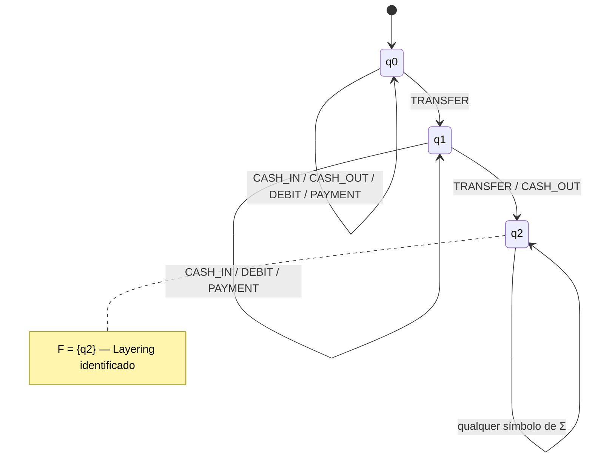

# Diário de Sprint 1 — Formalização do autômato
**Período:** Semana 1
**Grupo / tema:** Grupo 1 — Pré-filtragem via DFA/CEP para redução de complexidade em busca de SCC (Kosaraju)

**Equipe:** Grupo 1
**Integrantes:** Guilherme Lombardi, Ryan dos Santos Veloso, Caio Winkler Marangoni, Guilherme Liborio Camargo, Julia Emily Leonardo Barbosa
**Scrum Master do Sprint:** [PENDENTE: Inserir nome do Scrum Master da Sprint 1]
**Repositório GitHub (pesquisa/documentação):** https://github.com/Guilherme-Lombardi/AnaliseComplexidade_DeteccaoFraudes
**Sistema-base (código existente — NodeWatch):** https://github.com/1s4ntos/Sistema-de-Detec-o-de-Fraudes-em-Transa-es-Financeiras — commit-base `90be391` (o README do repositório de pesquisa referencia o mesmo projeto como https://github.com/1s4ntos/NodeWatch)

> Esta sprint **só formaliza o problema e o autômato** (pergunta de pesquisa, alfabeto, diagrama de estados, linguagem reconhecida) e seleciona o dataset de teste. **Não há** implementação de código, integração com o DFS/Kosaraju nem benchmark — isso é Sprint 2 e 3. O algoritmo de grafo (DFS/Kosaraju) **não é escolhido nem alterado** aqui: ele já existe no sistema-base (`find_cycles` em `src/algoritmos/cycle_detection.py`; `find_scc` em `src/algoritmos/scc.py`).

### Contrato desta sprint

| | Artefato | Quem usa depois |
|---|---|---|
| **Entra** | RFC do Grupo 1 (nada de sprint anterior) | — |
| **Sai** | Canvas de kickoff + pergunta de pesquisa fechada | Sprint 2, 3 e 4 |
| **Sai** | Especificação formal do DFA (5-tupla Q, Σ, δ, q0, F) + diagrama de estados | Sprint 2 **é obrigada a implementar exatamente esta especificação** |
| **Sai** | Dataset de teste selecionado (grafo de transações + SCCs fraudulentas conhecidas / ground truth) | Sprint 3 (benchmark) |
| **Sai** | Repositório, board, este diário | Sprints seguintes |

**Não sai daqui:** código do autômato, integração com DFS/Kosaraju, medições de desempenho.

---

## 1. Canvas de kickoff

| Pergunta | Resposta |
|---|---|
| Qual é a pergunta de pesquisa? | Em que medida a introdução de uma camada de pré-filtragem baseada em Autômatos Finitos Determinísticos reduz o volume de dados encaminhado e o tempo de resposta de um pipeline de detecção de fraudes bancárias em tempo real, quando comparada à varredura direta via DFS/Kosaraju? *(Recorte de complexidade: o filtro custa O(V + E) mais a ordenação por `step` e **não altera a ordem assintótica** do Kosaraju, que já é O(V + E); o ganho esperado está na redução da entrada da enumeração de ciclos simples, cujo pior caso é exponencial em \|V\|.)* |
| Qual é o alfabeto de entrada (Σ) do autômato (categorias de eventos de transação)? | Σ = {CASH_IN, CASH_OUT, DEBIT, PAYMENT, TRANSFER} — categorias do campo `type` do dataset PaySim. **Confirmado no arquivo do repositório** (`dados/exemplo_transacoes.csv`): as 5 categorias ocorrem (TRANSFER 11, PAYMENT 2, CASH_IN 1, CASH_OUT 1, DEBIT 1) e nenhuma outra. São também os 5 tipos tratados pelo sistema-base (`_TIPO_PRIORIDADE` em `cycle_detection.py`). [PENDENTE: confirmar a enumeração contra o arquivo completo do PaySim quando ele for baixado.] |
| O que o autômato decide ao aceitar/rejeitar um subgrafo? | Aceitar (encaminhar à detecção de ciclos/SCC) todo componente fracamente conexo cuja sequência de eventos, ordenada por `step`, contém um TRANSFER seguido — não necessariamente de imediato — de outro TRANSFER (circulação entre contas, *layering*) ou de um CASH_OUT (retirada após movimentação). Rejeitar os componentes sem esse padrão (ex.: só pagamentos, depósitos ou saques, sem movimentação entre contas), que são retirados antes da travessia DFS/Kosaraju. |
| Qual é o custo de um falso negativo (SCC fraudulenta descartada) e de um falso positivo (subgrafo aceito sem padrão suspeito)? | **FN:** componente com SCC fraudulenta descartado antes da detecção — a fraude escapa (custo crítico). **FP:** componente sem padrão suspeito aceito — custo extra **linear** (O(V + E)) no Kosaraju, mas potencialmente **exponencial em \|V\|** na enumeração de ciclos simples (`find_cycles`). Decisão ligada ao desenho: autômato conservador — na dúvida, manter o candidato (símbolo fora de Σ ⇒ componente aceito sem rodar o DFA; ver seção 2). **Medição na amostra (verificado):** FN = 0 de 3 componentes com fraude; FP = 0 (o único componente rejeitado não contém fraude). Estimativa de custo no PaySim completo: [PENDENTE: Inserir estimativas de custo FN/FP.] |
| Justificativa: por que um DFA/CEP é uma abordagem formal adequada para este pré-filtro? | O DFA reconhece o padrão em uma única passada por palavra, e cada transação aparece em exatamente uma palavra: o reconhecimento custa O(E) no total, com semântica formal e determinística (5-tupla), adequado a CEP em camada de borda. O pré-processamento (componentes fracamente conexos) é O(V + E), mais a ordenação por `step` (O(E log E), ou linear com *counting sort*, pois `step` é inteiro limitado). O filtro **não** reduz a ordem assintótica do Kosaraju (O(V + E)); ele ataca o gargalo registrado no sistema-base — a enumeração de todos os ciclos simples em `find_cycles`, pior caso exponencial em \|V\| — reduzindo o grafo que chega até ela. |

- [x] Pergunta de pesquisa escrita sem ambiguidade
- [x] Alfabeto de entrada definido e justificado
- [x] Custo de FN/FP explicitado e ligado ao desenho do autômato (conservador em caso de dúvida)

## 2. Especificação formal do DFA

- [x] Conjunto de estados (Q) definido, com significado de cada estado
- [x] Alfabeto (Σ) coerente com o canva da seção 1
- [x] Função de transição (δ) completa (tabela de transição)
- [x] Estado inicial (q0) e estados de aceitação (F) definidos
- [x] Diagrama de estados desenhado
- [x] Linguagem regular / expressão regular reconhecida pelo autômato descrita em português e formalmente

**Autômato:** M = (Q, Σ, δ, q0, F)

**Entrada do autômato (como um subgrafo vira uma palavra w ∈ Σ\*):**

1. Montar o multigrafo de transações (contas = vértices, transações = arestas) e particioná-lo em **componentes fracamente conexos** (direção das arestas ignorada) — O(V + E), por BFS ou *union-find*.
2. Para cada componente C, a palavra w_C é a sequência dos `type` de suas transações, em **ordenação estável por (`step`, ordem de aparição no arquivo)**.
3. Normalização: `type` com espaços removidos e em maiúsculas. Se algum símbolo de C ficar fora de Σ (vazio ou desconhecido), C é **aceito sem rodar o DFA** (política conservadora).
4. C aceito ⇒ o subgrafo induzido por C segue para `find_cycles` / `find_scc`. C rejeitado ⇒ descartado antes da travessia.

**Por que o recorte é correto:** toda SCC está contida em exatamente um componente fracamente conexo (vértices mutuamente alcançáveis estão ligados no grafo não direcionado). Portanto o filtro nunca divide uma SCC: ou ela passa inteira, ou é descartada inteira.

**Tabela de transição (δ):**

| Estado | Símbolo de entrada | Próximo estado |
|---|---|---|
| q0 | TRANSFER | q1 |
| q0 | CASH_IN, CASH_OUT, DEBIT, PAYMENT | q0 |
| q1 | TRANSFER, CASH_OUT | q2 |
| q1 | CASH_IN, DEBIT, PAYMENT | q1 |
| q2 | qualquer símbolo de Σ | q2 |

**Q =** {q0, q1, q2}
- q0 — **Início:** nenhuma movimentação entre contas (TRANSFER) observada.
- q1 — **Movimentação (Layering_em_curso):** um TRANSFER observado; aguardando uma segunda transferência ou uma retirada.
- q2 — **Layering_Identificado (aceitação):** TRANSFER seguido de outro TRANSFER ou de CASH_OUT.

**Σ =** {CASH_IN, CASH_OUT, DEBIT, PAYMENT, TRANSFER}
**q0 =** q0 (Início)
**F =** {q2}
**Linguagem reconhecida (descrição formal):** L(M) = Σ\* · TRANSFER · Σ\* · (TRANSFER ∪ CASH_OUT) · Σ\* — em português: toda sequência que contém uma transferência entre contas (TRANSFER) seguida, em algum momento posterior, de outra transferência (circulação do capital) ou de uma retirada (CASH_OUT); CASH_IN, DEBIT e PAYMENT podem aparecer em qualquer posição sem efeito. As demais sequências são rejeitadas.

**Propriedades conferidas:**
- δ é total: 3 estados × 5 símbolos = 15 transições definidas.
- L(M) coincide com a expressão regular acima — conferido por enumeração exaustiva de todas as 488.281 palavras com \|w\| ≤ 8 (0 divergências).
- M é mínimo: q2 é o único estado de aceitação, e q0 e q1 são distinguidos pela palavra TRANSFER (δ\*(q0, TRANSFER) = q1 ∉ F; δ\*(q1, TRANSFER) = q2 ∈ F).

**Nota de projeto (conservadorismo):** CASH_IN, DEBIT e PAYMENT são neutros em todos os estados (não iniciam nem quebram o padrão). A exigência de CASH_IN no início, presente na v3, foi removida: ela fazia o autômato rejeitar todas as fraudes conhecidas da amostra e o padrão TRANSFER → CASH_OUT do PaySim (ver seção 8). A extensão opcional da v3 (δ(q1, CASH_OUT) = q3) foi descartada, pois conflitava com a própria tabela da v3.

**Limites conhecidos (FN possíveis, a medir na Sprint 3):**
- componente sem nenhum TRANSFER (ex.: ciclo formado só por CASH_IN, CASH_OUT, DEBIT ou PAYMENT);
- componente com exatamente um TRANSFER e nenhum CASH_OUT depois dele — inclui o self-loop isolado (que o sistema-base classifica como ANOMALIA em `find_cycles`) e o ciclo de 2 contas em que o CASH_OUT ocorre antes do TRANSFER.

**Diagrama de estados (Mermaid):**

**Evidências (diagrama, link do documento/commit):** [PENDENTE: Inserir link do documento/commit com a especificação formal versionada]

## 3. Seleção do dataset de teste

- [x] Dataset (grafo de transações) identificado e sua origem documentada
- [x] SCCs fraudulentas conhecidas (ground truth) listadas ou localizadas no dataset *(na amostra do repositório; no PaySim completo, pendente)*
- [ ] Tamanho do grafo (nós/arestas) registrado, para dimensionar o benchmark da Sprint 3 *(registrado para a amostra: 15 nós / 16 arestas; falta o PaySim completo, que é a base de escala do benchmark)*

**Origem do dataset e N (nós/arestas):** PaySim — simulador sintético de transações de dinheiro móvel (Lopez-Rojas, Elmir & Axelsson, "PaySim: A financial mobile money simulator for fraud detection", EMSS 2016); dataset público "Synthetic Financial Datasets For Fraud Detection" (Kaggle). Grafo derivado: nós = contas (nameOrig/nameDest); arestas = transações (multigrafo direcionado ponderado). Dois níveis de dados:
- **Amostra de validação funcional (verificado):** `dados/exemplo_transacoes.csv` do sistema-base (commit `90be391`) — 16 transações no formato PaySim simplificado (6 das 11 colunas do PaySim: step, type, amount, nameOrig, nameDest, isFraud). **N = 15 nós (contas); E = 16 arestas (transações).** 4 componentes fracamente conexos; 3 SCCs de tamanho > 1 e 5 SCCs unitárias (C004, C005, C009, C010, EXTERNAL).
- **Base de escala do benchmark (Sprint 3):** PaySim completo. N (nós): [PENDENTE: Inserir número de nós]. E (arestas): [PENDENTE: Inserir número de arestas]. [PENDENTE: Inserir link/versão exata do arquivo usado pelo grupo.]

**Ground truth de SCCs fraudulentas (onde estão, quantas são):** critério de rotulagem — SCC de tamanho > 1 que contém ao menos uma transação interna com isFraud = 1. Na amostra (verificado com `find_scc` do sistema-base), são **3 SCCs fraudulentas**:

| SCC | Contas | Transações internas | Volume interno | Transação com isFraud = 1 |
|---|---|---|---|---|
| A | C001, C002, C003 | 4 | R$ 30.300,00 | linha 4 do CSV — step 2, TRANSFER C003 → C001, R$ 9.800,00 |
| B | C006, C007, C008 | 3 | R$ 8.850,00 | linha 10 do CSV — step 5, TRANSFER C008 → C006, R$ 2.900,00 |
| C | C011, C012, C013, C014 | 4 | R$ 30.800,00 | linha 17 do CSV — step 12, TRANSFER C014 → C011, R$ 7.400,00 |

PaySim completo: [PENDENTE: Inserir identificação das SCCs associadas a fraude — contas/IDs envolvidos e contagem.] **Risco a verificar:** se as contas de origem do PaySim raramente se repetirem, SCCs de tamanho > 1 serão raras ou inexistentes; nesse caso, o ground truth por SCC precisará de outro critério (ex.: componente fracamente conexo com isFraud = 1).

**Categorias do campo `type` (enumeração padrão PaySim):** CASH_IN, CASH_OUT, DEBIT, PAYMENT, TRANSFER. **Amostra (verificado):** TRANSFER 11, PAYMENT 2, CASH_IN 1, CASH_OUT 1, DEBIT 1; as 3 transações com isFraud = 1 são todas TRANSFER. Referência técnica: na documentação oficial do PaySim, as transações marcadas como fraudulentas (isFraud = 1) concentram-se em CASH_OUT e TRANSFER — ambas cobertas pelo padrão da seção 2. [PENDENTE: confirmar a distribuição das categorias no PaySim completo.]

**Análise de valores ausentes / incongruências:** **Amostra (verificado):** 0 campos vazios nas 6 colunas × 16 linhas; 0 linhas duplicadas; 0 self-loops; amount entre R$ 150,00 e R$ 10.000,00 (nenhum valor ≤ 0); step de 1 a 12, com 4 steps contendo 2 transações cada (steps 1, 2, 3 e 4) — daí a regra de desempate pela ordem no arquivo (seção 2); isFraud apenas com valores 0/1 (13 / 3). Incongruências identificadas:
- a conta `EXTERNAL` foge do padrão de ID `C###` e é usada como origem do CASH_IN;
- isFraud marca a transação que fecha cada ciclo, semântica diferente do PaySim, onde marca as transações do agente fraudador (TRANSFER/CASH_OUT);
- faltam 5 colunas do PaySim original (oldbalanceOrg, newbalanceOrig, oldbalanceDest, newbalanceDest, isFlaggedFraud);
- no sistema-base, o leitor de CSV descarta `step` (a classe `Edge` não tem esse campo e o exportador grava `step = 0`) — a Sprint 2 precisa preservá-lo, pois L(M) depende da ordem dos eventos.

PaySim completo: [PENDENTE: Inserir resultados da análise de missing/null por coluna (step, type, amount, nameOrig, nameDest, isFraud e demais colunas do schema) e incongruências identificadas.]

**Baseline de comparação (sistema-base, registrado para a Sprint 3):**
- `find_scc` (Kosaraju) é O(V + E) (`scc.py`). `find_cycles` enumera ciclos simples por *backtracking*, com pior caso exponencial em \|V\| (`cycle_detection.py`) — é nessa etapa que o pré-filtro pode trazer ganho.
- A CLI do sistema-base imprime "Complexidade: tempo O(V + E)" para a enumeração de ciclos (`src/main.py`, linhas 80–81), o que diverge da docstring do próprio módulo. Corrigir antes de usar essa saída como evidência.
- `_cycle_priority` reconstrói o mapa de arestas a cada ciclo, e `_enrich_components` percorre todas as arestas para cada componente — ambos O(C · E). Isso infla o tempo do baseline e deve ser corrigido ou isolado nas medições.
- A docstring de `cycle_detection.py` cita a "heurística de Johnson", mas a implementação não usa os conjuntos bloqueados do algoritmo de Johnson; portanto o limite O((V + E)(C + 1)) de Johnson não se aplica a ela.

## 4. Prova de conceito manual

- [x] Autômato executado "na mão" (sem código) em pelo menos 3 exemplos: 1 caso claramente aceito, 1 claramente rejeitado, 1 caso de borda
- [x] Resultado de cada caso confrontado com a expectativa (o desenho do autômato faz sentido?)

**Tabela de casos manuais:**

| Caso | Sequência de entrada | Estados percorridos | Estado final | Aceito/Rejeitado | Esperado? |
|---|---|---|---|---|---|
| 1 — Aceito claro | CASH_IN, TRANSFER, TRANSFER, CASH_OUT | q0 → q0 → q1 → q2 → q2 | q2 | Aceito | Sim — layering completo (entrada → movimentação → saída) |
| 2 — Rejeitado claro | PAYMENT, CASH_IN, DEBIT, CASH_OUT | q0 → q0 → q0 → q0 → q0 | q0 | Rejeitado | Sim — nenhum TRANSFER, logo nenhuma movimentação entre contas |
| 3 — Borda: símbolo neutro | CASH_IN, TRANSFER, PAYMENT, CASH_OUT | q0 → q0 → q1 → q1 → q2 | q2 | Aceito | Sim — PAYMENT é neutro em q1 e não quebra o padrão |
| 4 — Borda: janela incompleta | CASH_IN, TRANSFER, DEBIT | q0 → q0 → q1 → q1 | q1 | Rejeitado | Sim — um único TRANSFER, sem segunda transferência nem retirada |
| 5 — Padrão PaySim (tomada de conta) | TRANSFER, CASH_OUT | q0 → q1 → q2 | q2 | Aceito | Sim — rejeitado na v3 (FN); corrigido na v4 |
| 6 — Ciclo da amostra (SCC B) | TRANSFER, TRANSFER, TRANSFER | q0 → q1 → q2 → q2 | q2 | Aceito | Sim — circulação entre contas; rejeitado na v3 (FN) |
| 7 — Borda: ordem invertida | CASH_OUT, TRANSFER | q0 → q0 → q1 | q1 | Rejeitado | Sim — retirada antes da movimentação não forma o padrão (limite conhecido, seção 2) |

**Execução sobre a amostra (componentes fracamente conexos, ordem por `step`; conferida também por script de verificação):**
*Legenda: T = TRANSFER, P = PAYMENT, CI = CASH_IN, D = DEBIT, CO = CASH_OUT.*

| Componente | Contas | Palavra w_C | Estado final | Decisão | Contém SCC fraudulenta? |
|---|---|---|---|---|---|
| 1 | C001, C002, C003, C004, C005, EXTERNAL | T, T, T, T, P, P, CI, D | q2 | Aceito | Sim (SCC A) |
| 2 | C006, C007, C008 | T, T, T | q2 | Aceito | Sim (SCC B) |
| 3 | C009, C010 | CO | q0 | Rejeitado | Não |
| 4 | C011, C012, C013, C014 | T, T, T, T | q2 | Aceito | Sim (SCC C) |

Resultado: 3 de 3 SCCs fraudulentas preservadas (FN = 0) e nenhum componente aceito sem fraude (FP = 0). O filtro remove 1 de 4 componentes — 2 de 15 contas e 1 de 16 transações. Com o DFA da v3, os 4 componentes seriam rejeitados (FN = 3 de 3). A amostra é pequena e não representa a taxa de redução esperada no PaySim completo.

## 5. Scrum

- [ ] Papéis definidos (Product Owner = docente; Scrum Master do sprint; Development Team)
- [ ] Board criado (GitHub Projects ou Trello) com To do / Doing / Done
- [x] Backlog inicial com pelo menos 3 user stories

**User stories do backlog inicial:**
1. Como pesquisador, quero a especificação formal do DFA (5-tupla Q, Σ, δ, q0, F + diagrama de estados) revisada e versionada no repositório, para que a Sprint 2 a implemente exatamente como especificada. *(Alto impacto — artefato central do contrato da sprint.)*
2. Como pesquisador, quero o dataset PaySim documentado (origem, N de nós/arestas, distribuição do campo `type`, análise de missing e ground truth das SCCs fraudulentas), para dimensionar o benchmark da Sprint 3. *(Baixo esforço/alto impacto — dataset já indicado na pesquisa; falta documentar os números.)*
3. Como pesquisador, quero o board da sprint configurado (To do/Doing/Done) e os papéis registrados (PO = docente; Scrum Master; Dev Team), para rastrear as entregas e reduzir o risco de retrabalho. *(Baixo esforço/alto impacto — reduz riscos iniciais de organização.)*

**Link do board:** [PENDENTE: Inserir link do board (Jira/Trello/GitHub Projects)]

## 6. Diário de bordo (retrospectiva individual)

| Integrante | O que fiz nesta Sprint | Dificuldades | O que pretendo manter/ajustar |
|---|---|---|---|
| Guilherme Lombardi | [PENDENTE: Inserir registro diário] | [PENDENTE: Inserir dificuldades/ impedimentos] | [PENDENTE: Inserir o que manter/ajustar] |
| Ryan dos Santos Veloso | [PENDENTE: Inserir registro diário] | [PENDENTE: Inserir dificuldades/ impedimentos] | [PENDENTE: Inserir o que manter/ajustar] |
| Caio Winkler Marangoni | [PENDENTE: Inserir registro diário] | [PENDENTE: Inserir dificuldades/ impedimentos] | [PENDENTE: Inserir o que manter/ajustar] |
| Guilherme Liborio Camargo | [PENDENTE: Inserir registro diário] | [PENDENTE: Inserir dificuldades/ impedimentos] | [PENDENTE: Inserir o que manter/ajustar] |
| Julia Emily Leonardo Barbosa | [PENDENTE: Inserir registro diário] | [PENDENTE: Inserir dificuldades/ impedimentos] | [PENDENTE: Inserir o que manter/ajustar] |

## 7. Evidências gerais

- Link do canvas/RFC atualizado: [PENDENTE: Inserir link do canvas/RFC atualizado]
- Link da especificação formal do DFA: [PENDENTE: Inserir link do documento/commit da especificação formal do DFA]
- Link de commits desta Sprint: [PENDENTE: Inserir lista de commits da Sprint 1 (hash + descrição)]
- Link do board atualizado: [PENDENTE: Inserir link do board atualizado]
- Sistema-base (baseline do benchmark): https://github.com/1s4ntos/Sistema-de-Detec-o-de-Fraudes-em-Transa-es-Financeiras — commit `90be391`

## 8. Registro de revisão (v3 → v4)

- **DFA reformulado (4 → 3 estados):** a v3 exigia CASH_IN → TRANSFER → CASH_OUT e, com isso, rejeitava as 3 SCCs fraudulentas da amostra (formadas só por TRANSFER) e o padrão TRANSFER → CASH_OUT do PaySim — 100% de FN, contrariando a política conservadora declarada no canvas.
- **Extensão opcional removida:** δ(q1, CASH_OUT) = q3 conflitava com δ(q1, CASH_OUT) = q0 da tabela da v3; como a Sprint 2 precisa implementar a especificação exatamente, não pode haver transição opcional.
- **Entrada do autômato definida:** componente fracamente conexo, ordenação estável por `step`, normalização e regra para símbolos fora de Σ. Sem isso, "aceitar/rejeitar um subgrafo" não tinha tradução para uma palavra w ∈ Σ\*.
- **Texto de complexidade corrigido:** o custo exponencial é da enumeração de ciclos simples (`find_cycles`), não do Kosaraju (O(V + E)). A pergunta de pesquisa passa a falar em redução de volume e de tempo de resposta, alinhada ao README do repositório de pesquisa, que distingue redução de volume de mudança da ordem assintótica.
- **PENDENTEs preenchidos com dados verificados da amostra** (Σ, N/E, ground truth, distribuição de `type`, valores ausentes). Continuam pendentes os itens que dependem do PaySim completo, do board, do Scrum Master, dos links de commit e do diário individual.

---

## Rubrica de avaliação — Sprint 1 (nota de 0 a 4,0)

| Critério | Peso | O que caracteriza nota máxima | Nota atribuída | Observações |
|---|---|---|---|---|
| Canvas e pergunta de pesquisa | 0,5 | Pergunta sem ambiguidade; alfabeto e custo de FN/FP explícitos | | |
| Especificação formal do DFA | 1,5 | 5-tupla completa, diagrama de estados, linguagem reconhecida bem descrita | | |
| Dataset de teste selecionado | 1,0 | Origem documentada, ground truth localizado, N registrado | | |
| Scrum + diário de bordo | 1,0 | Papéis, board, backlog e diário reflexivo de todos | | |
| **Nota final da Sprint 1** | **4,0** | | **___ / 4,0** | |
